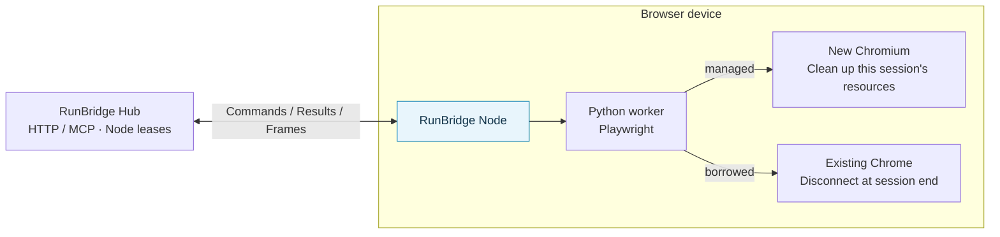

# RunBridge Node

**Make a local browser available to remote programs and agents.**

[简体中文](README.md) · English · [Quick start](#quick-start) · [Documentation](doc/README.en.md) · [Changelog (Chinese)](doc/project/版本发布记录.md) · [Issues](https://github.com/Pegasus-Yang/Run-Bridge-Node/issues)

[](pyproject.toml) [](LICENSE)

RunBridge Node is the browser execution component of RunBridge. It runs on the browser device, connects to [RunBridge Hub](https://github.com/Pegasus-Yang/Run-Bridge-Hub/blob/main/README.en.md), executes Playwright operations in an independent Python worker, and sends results and page frames back to Hub.

Use it to provide an isolated browser test environment, or to reuse an existing Chrome instance's pages and login state with its owner's authorization. Programs and agents access the device through Hub's HTTP / MCP interface; Node manages browser processes, endpoints, and page objects locally.

## Highlights

| Capability | What you can do |
| --- | --- |
| Managed browser sessions | Launch Chromium for a session and clean up its processes and temporary profile afterward |
| Existing Chrome reuse | Connect to an authorized local instance and retain its original pages and login state when disconnecting |
| One YAML file | Configure Hub, identity, and browser options; automatically enroll, probe, and connect on first startup |
| Central lease allocation | Let Hub manage claims, renewals, and release while Node handles capabilities and execution |
| Multiple instances per device | Provide separate Nodes with independent configurations, identities, and browser resources |
| Frames and cleanup status | Observe the actual page, report cleanup, and quarantine resources when cleanup cannot be confirmed |

## How it works and which mode to choose



| Choice | managed: isolated browser | borrowed: existing Chrome |
| --- | --- | --- |
| Typical use | Automated tests, independent tasks, agent MCP | Existing login state or a specific browser environment |
| Browser source | Chromium launched by Node for the session | Local Chrome instance explicitly authorized by its owner |
| Session end | Remove this session's browser and temporary profile | Disconnect; retain original pages and login state |
| Page streaming | Capture the managed page directly | Install the optional `visual` extra when needed |
| Client entry | Hub HTTP / MCP | Hub HTTP |
| Guide | [Managed Chromium](doc/user-guide/Playwright快速开始.en.md) | [Existing Chrome](doc/user-guide/Chrome复用快速开始.en.md) |

Inspect online status, occupancy, and capabilities in the [Hub dashboard](https://github.com/Pegasus-Yang/Run-Bridge-Hub/blob/main/doc/user-guide/节点总览.en.md). Managed mode is headless by default; subscribe to page frames through Hub. Node does not have a separate web management UI.

## Quick start

### 1. Install Node and prepare Chromium

On the **Node device**, prepare Git, Python **3.14.x**, and [uv](https://docs.astral.sh/uv/getting-started/installation/). First obtain a reachable Hub base URL and the original `enrollment.token` from the [Hub deployer](https://github.com/Pegasus-Yang/Run-Bridge-Hub/blob/main/README.en.md#quick-start). Save the token file to `~/Downloads/`.

These commands use a macOS / Linux shell and install managed Chromium support:

```bash
git clone https://github.com/Pegasus-Yang/Run-Bridge-Node.git
cd Run-Bridge-Node
uv sync --locked --no-dev --extra playwright -i http://mirrors.aliyun.com/pypi/simple/ --trusted-host mirrors.aliyun.com
.venv/bin/python -m playwright install chromium
```

`uv` creates `.venv` at the repository root. Linux also needs the browser's system libraries; see the [Playwright browser guide](https://playwright.dev/python/docs/browsers). For installation from a wheel in a separate directory, see [deployment](doc/deployment/部署与运行.en.md).

### 2. Save enrollment material and configuration

```bash
umask 077
mkdir -p .runbridge
cp -n ~/Downloads/enrollment.token .runbridge/enrollment.token
chmod 600 .runbridge/enrollment.token
```

Create `node.yaml` at the repository root, replacing `hub_url` with the actual Hub base URL:

```yaml
hub_url: http://hub.example:8787
enrollment_token_file: .runbridge/enrollment.token
tools:
  playwright: {}
```

This uses managed, headless Chromium, resource ID `chromium`, and identity file `.runbridge/node.json`. Relative paths resolve from the **YAML file's directory**.

### 3. Connect and hand off the resource

```bash
.venv/bin/runbridge-node run --settings node.yaml
```

Leave the terminal running. First startup enrolls, probes the browser, and connects; later starts reuse the identity. A separate `register` command is unnecessary.

Give the logged `node_id`, resource ID, and mode to the Hub deployer or client. Confirm **ONLINE**, fresh capabilities, and resource **READY / FREE** in Hub's dashboard. Follow the [Hub client guide](https://github.com/Pegasus-Yang/Run-Bridge-Hub/blob/main/doc/user-guide/调用方对接与使用.en.md) to claim Node, operate the page, close the session, and return Node. First startup needs neither a client access file nor Hub's claim credential in the Node process.

## Supported scope

- Current Node: **0.8.1**, paired with Hub **0.9.2**. Python **3.14.x** and matching Python Playwright are required. No separate Node.js/npm deployment or Playwright BrowserServer is needed.
- **33 project methods** are explicitly implemented; see the [Hub method reference](https://github.com/Pegasus-Yang/Run-Bridge-Hub/blob/main/doc/reference/Playwright方法表.en.md). Hub provides HTTP / MCP; Node performs local execution.
- A Node browser resource accepts one active session at a time. Use independent Node instances for concurrent tasks on the same machine.
- Borrowed authorization covers the entire browser instance. Completed page operations persist; releasing resources does not undo business changes.
- Browser sessions and Node leases are released separately. Return Node at batch end; a maintainer reviews unknown cleanup.
- Some CLI messages and Hub dashboard labels remain Chinese. Browser locale defaults are unchanged by the English documentation.

## Documentation and help

| Start here | Contents |
| --- | --- |
| [Documentation index](doc/README.en.md) | Reading paths for device maintainers, client handoff, and troubleshooting |
| [Quick start](doc/user-guide/快速开始.en.md) · [Deployment](doc/deployment/部署与运行.en.md) | Installation, enrollment, connection, handoff, restarts, and long-term operation |
| [Parameters](doc/reference/参数详解.en.md) · [Annotated YAML](doc/reference/examples/Node启动配置.en.yaml) | CLI, defaults, paths, and browser options |
| [Managed Chromium](doc/user-guide/Playwright快速开始.en.md) · [Existing Chrome](doc/user-guide/Chrome复用快速开始.en.md) | New browsers or an existing login environment |
| [Multiple Nodes](doc/deployment/同机运行多个Node.en.md) | Independent identities and concurrent tasks |
| [Page capture](doc/user-guide/浏览器画面采集.en.md) · [MCP preparation](doc/user-guide/MCP对接准备.en.md) | Frame support and agent resources |
| [Browser credentials and test data](doc/deployment/浏览器凭据与测试数据.en.md) · [Operations](doc/deployment/运行与排障.en.md) | Credential prompts, private data, disconnections, cleanup, and upgrades |

## Development and contributions

Use [Issues](https://github.com/Pegasus-Yang/Run-Bridge-Node/issues) or submit a Pull Request. Include both component versions, OS, browser version and mode, reproduction steps, and redacted errors.

Development uses the root `.venv`. The [contribution guide](CONTRIBUTING.en.md) covers setup and validation and links to the detailed development manual in Chinese. Maintained by [Pegasus-Yang](https://github.com/Pegasus-Yang).

## License

This project uses the [MIT License](LICENSE). Third-party dependencies retain their respective licenses.
