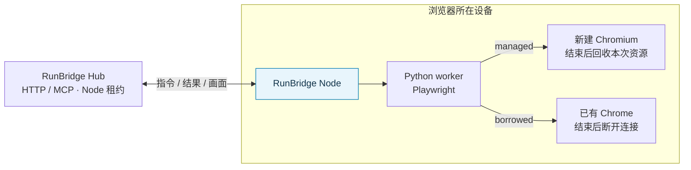

# RunBridge Node

**把本机浏览器作为程序和 Agent 可使用的远程执行资源。**

简体中文 · [English](README.en.md) · [快速开始](#快速开始) · [完整文档](doc/README.md) · [更新日志](doc/project/版本发布记录.md) · [问题反馈](https://github.com/Pegasus-Yang/Run-Bridge-Node/issues)

[](pyproject.toml) [](LICENSE)

RunBridge Node 是 RunBridge 的浏览器执行端。它部署在浏览器所在设备，主动连接 [RunBridge Hub](https://github.com/Pegasus-Yang/Run-Bridge-Hub)，在独立 Python worker 中通过 Playwright 执行操作，并将结果与页面画面传回 Hub。

适合提供独立的浏览器测试环境，或在所有者授权后复用已有 Chrome 的页面与登录状态。程序与 Agent 通过 Hub 的 HTTP / MCP 使用设备，浏览器进程、端点和页面对象由 Node 在本机管理。

## 功能亮点

| 能力 | 可以做什么 |
| --- | --- |
| 独立的受管理浏览器 | managed 模式为会话新建 Chromium，结束后回收本次进程和临时 Profile |
| 复用已有 Chrome | borrowed 模式连接已授权的本机实例，释放连接后保留原页面和登录状态 |
| 一份 YAML 启动 | 统一配置 Hub、身份和浏览器选项，首次自动登记、探测并上线 |
| 统一分配使用权 | Hub 管理整个 Node 的领取、续租和释放，Node 专注能力与执行 |
| 同机多个实例 | 使用独立配置与身份提供多个 Node，各自管理浏览器资源 |
| 页面画面与清理状态 | 观察实际页面、上报清理结果，未确认清理完成时保留隔离状态 |

## 工作方式与模式选择



| 选择 | managed：独立浏览器 | borrowed：已有 Chrome |
| --- | --- | --- |
| 典型场景 | 自动化测试、独立任务、Agent MCP | 已登录页面或特定浏览器环境 |
| 浏览器来源 | Node 为会话新建 Chromium | 所有者明确授权的本机 Chrome 实例 |
| 会话结束 | 回收本次浏览器与临时 Profile | 断开连接，保留原页面和登录状态 |
| 页面画面 | 直接采集受管理页面 | 按需安装可选 `visual` 扩展 |
| 调用入口 | Hub HTTP / MCP | Hub HTTP |
| 详细步骤 | [受管理 Chromium](doc/user-guide/Playwright快速开始.md) | [Chrome 复用](doc/user-guide/Chrome复用快速开始.md) |

Node 的在线状态、资源占用和能力可在 [Hub 节点总览](https://github.com/Pegasus-Yang/Run-Bridge-Hub/blob/main/doc/user-guide/节点总览.md)查看。managed 默认无头运行，页面画面可经 Hub 订阅；Node 不提供独立的网页管理界面。

## 快速开始

### 1. 安装 Node 并准备浏览器

在 **Node 设备**准备 Git、Python **3.14.x** 和 [uv](https://docs.astral.sh/uv/getting-started/installation/)。先由 [Hub 部署者](https://github.com/Pegasus-Yang/Run-Bridge-Hub#快速开始)提供可达基址和真实 `enrollment.token` 文件，文件保存到 `~/Downloads/`。

以下命令使用 macOS / Linux shell，默认部署 managed Chromium：

```bash
git clone https://github.com/Pegasus-Yang/Run-Bridge-Node.git
cd Run-Bridge-Node
uv sync --locked --no-dev --extra playwright -i http://mirrors.aliyun.com/pypi/simple/ --trusted-host mirrors.aliyun.com
.venv/bin/python -m playwright install chromium
```

`uv` 在仓库根目录创建 `.venv`。Linux 还需准备浏览器系统库，见 [Playwright 浏览器说明](https://playwright.dev/python/docs/browsers)。已有 wheel 的独立目录安装方法见[部署与运行](doc/deployment/部署与运行.md)。

### 2. 保存登记文件与配置

```bash
umask 077
mkdir -p .runbridge
cp -n ~/Downloads/enrollment.token .runbridge/enrollment.token
chmod 600 .runbridge/enrollment.token
```

在仓库根目录创建 `node.yaml`，把 `hub_url` 换成收到的实际 Hub 基址：

```yaml
hub_url: http://hub.example:8787
enrollment_token_file: .runbridge/enrollment.token
tools:
  playwright: {}
```

此配置采用 managed Chromium、无头运行、资源 ID `chromium`，身份默认保存在 `.runbridge/node.json`。相对路径以 **YAML 所在目录**为准。

### 3. 上线并交付资源

```bash
.venv/bin/runbridge-node run --settings node.yaml
```

保留终端。首次自动登记、探测浏览器并上线，后续复用身份，无需先执行 `register`。

把日志中的 `node_id`、资源 ID 与模式交给 Hub 部署者或调用方。在 Hub 总览确认 **ONLINE**、能力非过期、资源 **READY / FREE**，再按 [Hub 调用方教程](https://github.com/Pegasus-Yang/Run-Bridge-Hub/blob/main/doc/user-guide/调用方对接与使用.md)领取 Node、执行页面操作、关闭会话并交还 Node。首次上线无需访问文件，也无需向 Node 提供 Hub 申请凭据。

## 支持范围

- 当前 Node **0.8.1**，配套 Hub **0.9.2**，需要 Python **3.14.x** 和匹配的 Python Playwright；无需单独部署 Node.js/npm 或 Playwright BrowserServer。
- 当前显式实现 **33 项项目方法**，以 [Hub 方法表](https://github.com/Pegasus-Yang/Run-Bridge-Hub/blob/main/doc/reference/Playwright方法表.md)为准。Hub 提供 HTTP / MCP 入口，Node 负责本机执行。
- 同一 Node 的浏览器资源同时只接受一个活动会话；同机并行任务可部署独立 Node 实例。
- borrowed 授权范围为整个浏览器实例，已发生的页面操作会保留；资源释放不撤销业务修改。
- 浏览器会话与 Node 租约分别释放；整批结束还需交还 Node，清理未知时由维护者核查。

## 文档与帮助

| 从这里开始 | 内容 |
| --- | --- |
| [完整文档导航](doc/README.md) | 按设备维护、调用方交接和排障划分的阅读路线，含英文入口 |
| [快速开始](doc/user-guide/快速开始.md) · [部署与运行](doc/deployment/部署与运行.md) | 安装、登记、上线、交付、重启和长期运行 |
| [参数详解](doc/reference/参数详解.md) · [注释 YAML](doc/reference/examples/Node启动配置.yaml) | CLI、默认值、路径规则与浏览器选项 |
| [受管理 Chromium](doc/user-guide/Playwright快速开始.md) · [Chrome 复用](doc/user-guide/Chrome复用快速开始.md) | 新建浏览器或使用已有登录环境 |
| [同机多个 Node](doc/deployment/同机运行多个Node.md) | 独立身份、多实例和并行任务 |
| [页面画面](doc/user-guide/浏览器画面采集.md) · [MCP 准备](doc/user-guide/MCP对接准备.md) | 画面能力与 Agent 资源准备 |
| [浏览器凭据与测试数据](doc/deployment/浏览器凭据与测试数据.md) · [运行与排障](doc/deployment/运行与排障.md) | 凭据提示、私有数据、断线、清理与升级 |

## 开发与贡献

欢迎通过 [Issues](https://github.com/Pegasus-Yang/Run-Bridge-Node/issues) 反馈或提交 Pull Request。请附上两端版本、操作系统、浏览器版本与模式、复现步骤和已隐藏秘密的错误信息。

源码开发使用根目录 `.venv`，依赖同步、pytest 与隔离浏览器测试见[本地开发与联调](doc/development/本地开发与联调.md)；提交范围与验证要求见[贡献指南](CONTRIBUTING.md)。项目由 [Pegasus-Yang（天马）](https://github.com/Pegasus-Yang)维护。

## 许可证

本项目采用 [MIT License](LICENSE)。第三方依赖遵循各自的许可证。
