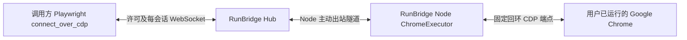

# RunBridge 已有 Chrome 复用

[文档导航](../README.md) · [使用指南](../user-guide/Chrome复用快速开始.md) · [会话接口](../reference/会话接口与原生连接.md)

本文件描述 0.4.0 沿用的 R4 实现。Chrome 已由用户运行并登录，Node 仅连接所有者明确配置的本机 CDP 端点。首期使用整个浏览器实例授权；单标签页扩展桥接仍为后续路线。

## 接入与所有权

Node 的 `chrome.py` 负责本地授权配置、只读版本探测、原生转发和连接清理。Hub 沿用单 Worker、内存预约、资源许可和租期；当前 SQLite 为 v3。Chrome 路线复用会话表，新增 mcp_requests 仅用于受管理 MCP 请求恢复，不增加 Redis 或浏览器 RPC。两端查询客户端须一起升级到 0.4.0；仍使用控制合同版本 1，新能力和会话字段不保证旧版严格校验客户端可以解析。

`run --chrome-config` 与 `run --playwright-config` 互斥，每个 Node 仍只提供一个浏览器资源位。前者资源类型为 `BORROWED_CHROME_CDP`、后端 `chrome-cdp`、默认 ID `chrome`；后者受管理 Chromium 行为保持原样。复用路线不需要 Node.js、npm Playwright 或下载新浏览器；调用方使用官方 Playwright SDK，验收锁定 1.63.0。

## 授权范围

所有者配置必填 `authorization_scope=BROWSER_INSTANCE` 和完整 `ws://127.0.0.1:<端口>/devtools/browser/<浏览器ID>`；IPv6 回环 `::1` 也接受。Node 拒绝 HTTP 自动发现、页面端点、远程地址、用户信息及查询参数。固定浏览器 ID 避免同一端口后来出现其他实例时自动换绑；Chrome 重启后需要所有者重新确认端点并重启 Node。

范围是该浏览器端点可见的全部页面及上下文，包括可访问的 Cookie 和站点存储，不提供按标签页、网站或账号隔离。相同 Profile 的页面共享登录状态。可复用登录不表示业务会话永不过期，也不保证脚本操作不会主动退出账号。

基础能力快照报告资源 ID、实例授权、Chrome 版本及就绪/占用；不把 CDP 地址、标签页 URL、页面标题、Cookie 或 Profile 路径写入 Hub。申请、查询、连接和释放继续校验节点、资源与创建许可；调用方不能提交端点、启动参数或修改授权范围。版本请求头只用于兼容性检查，不代替 Bearer 认证。

所有者须理解整个实例授权后再交付对接码。CDP 提供页面脚本和浏览器级操作，本模式是可信调用方的实例许可，不是对任意网页脚本的沙箱。选择原页面的 URL 只是调用脚本的选择规则，不构成服务端单页面授权。

## 登录与原页面

启动和重新接入时只读调用 `Browser.getVersion`，不创建、复制、清空或导入 Profile。会话准备再次连接同一个端点并核对 Chrome 版本，失联时准备失败并上报 UNAVAILABLE；能力快照不等于浏览器持续可用，重新启用需重启 Node 完成探测。

调用方使用 `chromium.connect_over_cdp(..., no_defaults=True)`，通过已有 `browser.contexts` 和 `context.pages` 获取原页面。`no_defaults` 避免默认下载、焦点及媒体覆盖；不要为了复用登录调用 `new_context()`。该参数由调用方设置，服务不会重写执行载荷替调用方补参数。[官方 CDP API](https://playwright.dev/python/docs/api/class-browsertype#browser-type-connect-over-cdp)

CDP 的能力覆盖不同于受管理浏览器的 Playwright 原生连接。首期验证原页面 DOM/Locator 操作、截图、Cookie/localStorage 和断开；未承诺完整下载、Trace、文件传输、最小化、锁屏、所有后台状态或任意 Chrome 版本。

## 断开与清理

一个资源同一时刻只允许一个会话，一个会话只有一个调用连接。Node 借用连接中不持有浏览器 PID、进程组、Profile 所有权或自建浏览器清理路径；不会调用受管理浏览器的关闭/强杀/目录清理逻辑。

独占以 Node/资源 ID 为边界；所有者应仅将一个 Chrome 实例配置给一个 Node。当前没有跨 Node 识别同一 Chrome 端点并去重的机制。

SDK `browser.close()`、管理 DELETE、许可撤销/到期、会话到期、Node 停止、控制断线和 Hub 重启均结束本次连接。不会自动关闭用户原页面、退出 Chrome 或删除 Profile。Node 关闭的是本机 WebSocket；Chrome 会解除该连接的调试附加。调用方显式执行页面关闭、导航、修改 Cookie 等操作仍按官方工具语义生效，断开不回滚这些操作。

Node 在 CDP 入口明确拒绝 `Browser.close`、`Browser.crash` 和不透明旧式 `Target.sendMessageToTarget`，返回原生错误 `-32000 / RUNBRIDGE_BORROWED_BROWSER_COMMAND_FORBIDDEN`。Playwright 的连接释放与 CDP 的退出浏览器命令不同，前者已实测不会退出 Chrome。[连接型 Browser.close](https://playwright.dev/python/docs/api/class-browser#browser-close)

`cleanup=COMPLETE` 在借用模式表示本次本机连接已经释放，不表示 Chrome 已退出或业务成功。未获确认时保留 UNKNOWN；强杀 Node 或重启 Hub 时，服务端旧会话可为 INTERRUPTED/UNKNOWN，即使后续直接观察证明原目标已解除附加、浏览器与登录仍在。正常停止 Node 可报告 INTERRUPTED/COMPLETE。重连只接受新会话，旧 Browser/Context/Page 对象失效，无动作重放。

借用连接清理异常时 Node 上报 UNAVAILABLE/UNKNOWN，停止新会话；重启 Node 后重新探测固定端点。它没有会在进程退出后继续存活的自建浏览器子进程，因此不复用受管理模式的 PID 隔离标记。

## 可选画面流

Node 安装 visual extra 后，在 ACTIVE 会话中启动独立观察连接和采集进程；Hub 查询附带 visual，提供只读数据流，由调用方展示。页面 ID 与 PNG 仅在已授权会话的内存通道中存在，不写入基础能力快照或会话记录。切换目标不改变实例授权；结束时还需确认自己创建的采集进程与临时目录已清理。详见[画面采集与分发](浏览器画面采集与分发.md)。
