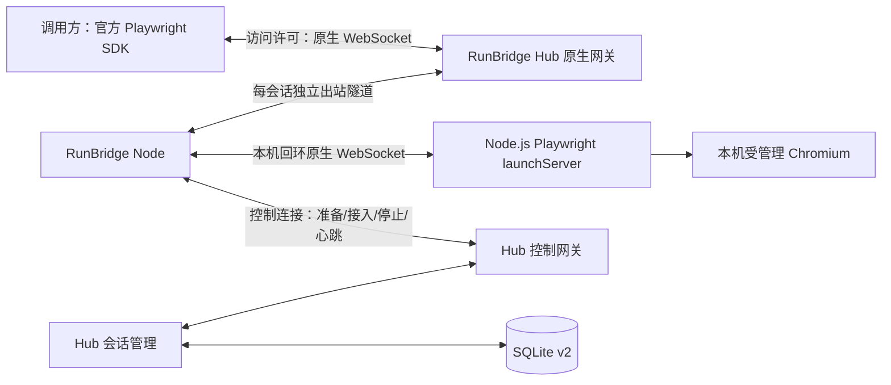

# RunBridge Playwright 执行与会话管理

[文档导航](../README.md) · [会话接口](../reference/会话接口与原生连接.md) · [阶段验收](../project/Playwright阶段验收记录.md)

当前版本为 0.5.0；本文说明受管理 Chromium 路线，已有 Chrome 的路线见[Chrome 复用与授权清理](Chrome复用与授权清理.md)。在 R0/R1 之上完成 R2 的资源/会话部分和 R3 的受管理 Chromium 原生接入。R2 的独立业务 HTTP 执行、Appium/ADB 和容量压测未实施。本文件描述当前代码，定稿路线保留在 `doc/design/`。

## 执行路径与模块

| 项目/模块 | 职责 |
| --- | --- |
| Hub `sessions.py` | 许可范围、SDK 版本、独占申请、租期、清理确认和重启中断 |
| Hub `native.py` | 调用方入口、节点出站隧道、文本/二进制逐消息转发 |
| Hub `service.py` / `gateway.py` | 稳定身份、连接代次、短临界区、控制发送串行与能力快照 |
| Hub `store.py` | v1 自动迁移到 v2，保存节点/许可/会话元数据 |
| Node `runtime.py` | 本地启动配置、独立 npm 锁文件、浏览器缓存和自建进程清理 |
| Node `executor.py` | 实际启动探测、单 Chromium 资源位、隧道、SDK 头转交和停止 |
| Node `playwright_runtime/server.mjs` | 公开 `chromium.launchServer()` / `BrowserServer.close()`，stdin EOF 回收 |
| Node `client.py` / `cli.py` | 异步控制连接、CLI 会话管理；启动浏览器期间心跳继续 |

两端分别保留 `protocol.py`，通过 JSON 合同通信。Hub 不导入 Node 包；官方执行载荷不经过 Pydantic 模型，也不逐 API 翻译。

Python SDK 与 npm Playwright 锁定 1.63.0；官方原生连接要求主、次版本匹配。Hub 在资源申请时检查调用方声明版本，并在原生握手中检查实际 SDK `User-Agent`。版本声明用于兼容性检查，节点身份和访问许可仍由各自 Bearer 凭据验证。[官方远程连接](https://playwright.dev/python/docs/api/class-browsertype#browser-type-connect)

## 资源与授权

Node 不带 `--playwright-config` 或 `--chrome-config` 时保持 R1 控制模式，不开放浏览器资源。启用时每个 Node 提供一个资源位，默认 ID 为 `chromium`、类型为 `MANAGED_CHROMIUM`。本地实际启动并关闭一次浏览器后才报告 READY；安装目录存在不等于就绪。每次申请再启动一个新的受管理实例，Context/Page 的数量与操作由官方 SDK 决定。

启动参数由节点所有者本地配置，以 Node.js `launchServer` 的字段名表示。调用许可不能上传 `executablePath`、环境变量或其他启动配置。`host`、`port`、信号管理由 Node 固定；不支持的配置键会明确校验失败。已支持字段和外层准备上限见[配置参考](../reference/会话接口与原生连接.md)。

Hub 在同一短临界区复核许可、节点代次、资源准备与占用，并先占用再发送启动命令。Node 再次检查本机资源。查询中的占用取节点报告与 Hub 当前预约的约束结果，不能依据迟到的 FREE 报告抢占正在准备的实例。

会话归属于创建它的许可；同一节点的另一个许可不能查询、连接或释放它。一个会话只允许一条调用方原生连接，连接后不透明重连 SDK 对象。

## 生命周期与清理

| 状态 | 含义 |
| --- | --- |
| PREPARING | 已预约资源，Node 正在启动浏览器与出站隧道 |
| READY | 本机浏览器与隧道已确认，等待官方 SDK |
| ACTIVE | 已接受调用方原生连接 |
| CLOSING | 已停止接入并请求清理，占用仍保留 |
| CLOSED | 会话正常结束；必须同时读取 cleanup |
| FAILED | 准备失败 |
| INTERRUPTED | 控制失联、服务器重启或执行通道故障 |

在受管理模式下，`cleanup=COMPLETE` 表示 Node 已确认回收自建进程和本次专用临时目录；`PENDING` 表示正在等待；`UNKNOWN` 表示未获确认。显式释放等待最多 10 秒，并返回真实状态。清理未知时不会把当前代次资源提前释放。

Node 将清理未知写入运行时目录 `cleanup-unknown-<node_id>.json`，记录本次 helper/browser PID，不含凭据；重启后仍报告 UNAVAILABLE/UNKNOWN。只有节点所有者核对自建进程已经退出后才能移除标记并重启 Node。新代次的真实 READY/FREE 报告可解除旧代次预约，但不会改写旧会话的历史 cleanup。

会话租期默认 300 秒，可取 1–3600 秒；有效期限不晚于访问许可到期。新执行入口即时校验许可/期限，转发每条消息时检查会话状态与期限，0.25 秒周期检查也会关闭未接入的 READY 会话。撤销许可先写 SQLite，再关闭相关连接并请求清理；撤销接口返回不等于清理已经确认。

Node 为每次浏览器创建运行时目录下的专用 sessions/browser-* 临时目录，并给 helper 指定 TMPDIR。正常退出使用官方 close；异常时只回收本次创建的 helper 和已核验的浏览器独立进程组，确认退出后清理该专用目录，不删除用户配置的外部输出目录。Node 失联时取消执行并回收自己的浏览器。Hub 重启把未终止的持久会话标为 INTERRUPTED/UNKNOWN，删除原生入口，新节点连接重新探测，不复活旧 Browser/Context/Page，也不重放任何协议调用。保留的历史终止记录不被复活。

`execution_outcome` 只取 `NOT_STARTED`、`NOT_TRACKED`、`OUTCOME_UNKNOWN`。网关不追踪每个操作的业务结果；即使某次操作断线前已生效，也不会代替调用方判断或重放。

## 转发与存储

控制消息应用上限为 64 KiB，原生单消息上限为 16 MiB。原生文本与二进制按顺序转发，未知原生字段保留，发送直接等待下游；Node 两个原生连接的库缓冲上限各为 4，不另设无界应用队列。文件大小和单协议消息大小不同；大文件是否被 SDK 分块由原生工具决定，超限会关闭连接，不静默截断。

Hub 固定单 ASGI Worker、asyncio，当前 CLI 使用 Uvicorn `websockets` 后端，`ws_max_size=16 MiB`、`ws_max_queue=4`。R1 时的 SansIO 后端在本次锁定版本中对 HTTP 拒绝握手记录误报，因此当前改用已完成真实验收且能明确配置队列上限的后端；该实现有上游弃用提示，升级 Uvicorn/websockets 前要复核拒绝握手、消息上限和背压。[Uvicorn 配置](https://uvicorn.dev/settings/)

SQLite v2 新增 `sessions`；保存公开状态、归属、代次与时间，不保存启动秘密、本机端点或执行帧。高频心跳和原生载荷不逐条落库。已结束的当前路由会从内存移除，历史元数据仍保存于 SQLite；清理未知的当前预约继续保留。

## 验证范围

已验证本机 macOS arm64、独立 Hub/Node 进程、官方 Python SDK 的 Browser/Context/Page/Locator、弹窗/新页面、路由回调、PNG、文件上传/下载、Trace、原生 TimeoutError、授权拒绝、资源冲突、撤销、租期和正常/异常重启。

原生方法调用错误保持 SDK 原始内容；浏览器启动失败作为管理准备错误返回公开错误码，helper 不把可能含本地启动秘密的原始日志交付调用方。启动失败排查见[运行与排障](../deployment/Playwright运行与排障.md)。

R4 Chrome CDP 的实际验收另见[Chrome 记录](../project/R4Chrome复用验收记录.md)。本文件的受管理矩阵仍以 macOS 为基线，扩展、Firefox/WebKit、独立 HTTP 执行、Appium、远程 TLS/NAT、受管理 Linux/Windows、超大输出/慢接收者压力和 100 在线/10 并发尚未验收。已有 Chrome 模式另已完成[Ubuntu ARM64 跨机器与字体测试](../project/虚拟机Node跨机器验收记录.md)，不推及受管理后端。该矩阵证明代表性原生能力可用，不等于对 Playwright 所有方法逐项认证。

## 受管理 MCP 与临时目录更新

0.5.0 的 Node 用专用探测页面确认 `managed_visual=cdp-png`；Hub MCP 持有的同一页面可提供持续画面，详见[画面架构](浏览器画面采集与分发.md)。普通 SDK 对象归属保持原有语义。浏览器临时文件位于私有短路径 `/tmp/rb-*`（POSIX），避免长 runtime_directory 使 Chromium UNIX SingletonSocket 超长。仅实际进程退出确认后删除，UNKNOWN 保留目录及隔离。

新增实际范围为 Ubuntu ARM64、Playwright 1.63.0、Chromium 153.0.8010.12 的受管理 MCP 操作和持续画面；历史 macOS 矩阵保留原验证范围，不扩展为全部 SDK 方法认证。详见[DSH 与受管理画面联调](../project/DSH与受管理画面联调.md)。
