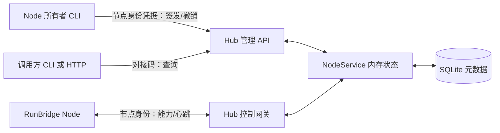

# RunBridge R0 与 R1 基础实现（历史基线）

> 本文件正文保留 0.1.0 的历史基线，文中的“尚未实现”以当时范围理解。0.4.0 的会话、SQLite v2、浏览器执行和画面已另有[当前架构](Playwright执行与会话管理.md)、[Chrome 架构](Chrome复用与授权清理.md)及[画面架构](浏览器画面采集与分发.md)。

[文档导航](../README.md) · [验收记录](../project/R0与R1验收记录.md)

当前实现覆盖两个独立 Python 项目的初始化、依赖锁定、节点登记与身份认证、控制连接、心跳、能力查询，以及调用许可的签发、范围、到期和撤销。

## 两端结构

| 项目 | 模块 | 当前职责 |
| --- | --- | --- |
| Hub | `app.py`、`settings.py`、`cli.py` | ASGI 生命周期、配置、单 Worker 启动与登记凭据生成 |
| Hub | `api.py` | 登记、许可创建/查询/撤销、节点与能力查询 |
| Hub | `gateway.py` | 验证节点身份，接收 v1 控制消息，处理超时与断开 |
| Hub | `service.py` | 凭据范围、连接代次、在线状态、资源可见性与快照 |
| Hub | `store.py` | aiosqlite 单连接线程、短事务、版本 1 SQLite 元数据 |
| Node | `config.py`、`cli.py` | 私有身份/对接文件，以及登记、运行、许可和查询命令 |
| Node | `client.py` | HTTP 管理调用、WebSocket 握手、心跳确认、自动重连 |
| Node | `capabilities.py` | 当前环境的安装元数据；不启动浏览器或设备驱动 |
| 两端 | 各自的 `protocol.py` | 独立维护相同 v1 JSON 合同，无跨项目 Python 导入 |

## 登记与身份

Hub 由部署方设置首次登记凭据。Node 在第一次登记请求前生成并私有保存稳定 `node_id` 和高熵 `node_token`，登记请求使用单独的登记凭据。相同 ID 与相同身份可幂等重试；相同 ID 与其他身份返回冲突，不能覆盖已有节点。

运行和重连仅使用节点身份，不再需要登记凭据。数据库保存随机凭据的 SHA-256 验证摘要，不保存原值。节点所有者使用节点身份签发单独的 `access_token`；调用方只需要这个对接码即可查询许可范围内的节点和资源。

## 控制生命周期

认证成功后 Hub 分配持久递增的连接代次，发送 `welcome`。Node 先报告能力并取得确认，然后发送应用心跳；Hub 返回当前代次、观察时间和心跳计数。

- `PREPARING`：控制连接存在，尚未接收本代次的能力报告。
- `ONLINE`：本代次已报告能力，控制活动未超时。
- `OFFLINE`：当前没有有效控制连接；可返回标记为过期的持久能力快照。

同一身份的新连接替换旧连接，旧连接收到关闭码 4001 并停止；旧连接清理不会移除新连接的状态。网络中断后 Node 以 0.5 秒起、最多 10 秒的退避重新连接。身份被拒绝、控制合同错误或同身份连接被替换时停止并明确报告。

默认应用心跳间隔 30 秒、超时 90 秒。Node 同时检查应用确认超时；Hub 按控制活动超时关闭连接。64 KiB 的控制消息上限、Node 有界接收队列和原生执行面分离的设计保持一致；原生执行流尚未实现，不能套用控制消息限制来裁剪原生载荷。

## 元数据与恢复

SQLite 中有 `nodes` 与 `grants` 两类表：登记身份、连接代次、能力快照、最后观察时间，以及许可范围、有效期和撤销时间。数据格式通过 `PRAGMA user_version = 1` 标识。

活 WebSocket、在线状态和心跳计数在进程内存。高频心跳不逐条写库；连接建立、能力报告和断开更新相关元数据。Hub 重启后从空连接表开始，旧能力快照标记为过期，Node 重新认证和报告能力后才再次在线。

## 能力报告边界

R1 实际报告主机/Python/客户端版本、控制协议支持，以及 HTTPX、Playwright Python 包和 Appium/ADB 可执行文件的安装线索。Appium/ADB 没有运行版本或设备探测；Playwright Python 包版本不代表 Node.js 浏览器服务已经准备。

默认执行资源目录为空。除 `runbridge-control-v1` 外，执行后端覆盖标记为 `NOT_IMPLEMENTED`。查询包含观察时间、年龄和 `capabilities_stale`；安装、在线和设备就绪是不同状态。资源范围许可会过滤资源及对应后端，不能借其他节点的对接码查询此节点。

## 尚未实施

R2–R6 的资源占用/执行会话、节点侧业务 HTTP 请求、Playwright 原生转发、已有浏览器复用、Appium/真机操作和容量压测。当前通过的是本机控制通道与管理 API 验收，未证明 100 在线/10 执行容量、远程 TLS 部署或跨操作系统安装。
