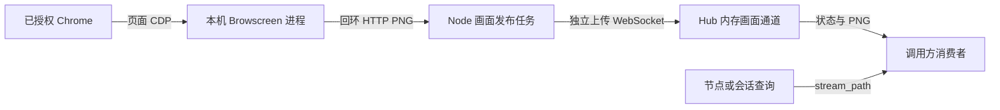

# 浏览器画面采集与分发

[文档导航](../README.md) · [数据流接口](../reference/浏览器画面流接口.md) · [接入指南](../user-guide/浏览器画面流接入.md)

本文件描述 RunBridge 0.4.0 的画面实现。首期只支持 `chrome-cdp` / `BORROWED_CHROME_CDP`。Hub 接收和分发数据，不提供画面展示页；调用方通过原有查询发现数据流，并自行解码、展示。

## 数据路径

原生 Playwright/CDP 执行、节点控制与画面使用不同连接。画面消息不进入原生协议、控制确认或 SQLite；画面失败不会修改执行结果，也不会关闭原生路由。底层浏览器本身失联仍由原有执行逻辑处理。

## Node 生命周期

`visual_capture.py` 先检查 Browscreen 满足 `>=0.3.1,<0.4.0` 且非预发布，再在隔离进程中探测导入。探测、`visual_worker.py` 加载和两端上传握手采用同一版本范围，并使用 `packaging` 按 Python 分发版本规则比较。基础 Node 模块不导入 Browscreen、FastAPI 或 Pillow；未安装、版本不受支持或导入失败时不声明画面协议。配置 Chrome 后端且探测可用时，在原后端 `declared_protocols` 中增加 `runbridge-visual-v1`。

`chrome.py` 仅在现有执行会话被激活后启动 `VisualPublisher`。READY 会话和单纯在线的 Node 不启动采集。`visual.py` 通过固定实例的独立浏览器连接读取目标目录，初次只有一个页面时自动选择；有多个页面时等待调用方选择。已选页面关闭后等待新的选择，不按页面顺序自动换绑。

页面地址只能由本机授权端点和该实例返回的目标 ID 生成，调用方只能提交目标 ID。读取目标目录不激活或操作页面；选择单页仍不改变 `BROWSER_INSTANCE` 的授权范围。

每个选中页面拥有一个私有临时目录和一个 `CaptureProcess`。`.cdp` 只写入该采集实例的页面地址，权限为 0600；不使用其他工具的 `.mouse`。`visual_worker.py` 在自身绑定的随机回环套接字上运行 Browscreen 应用，向父进程交付端口。父进程持有 Hub 凭据，采集进程不接收节点令牌。

采集进程监视父进程管道 EOF；正常结束或父进程消失时退出采集、断开观察连接，并移除自身 `.cdp`、`.mouse` 和空目录。Node 限时等待，必要时只终止自己创建的采集进程。进程或目录清理未确认时，整体清理返回 UNKNOWN，不能根据 Chrome 仍存活推断 COMPLETE。

## 发送与接收

Node 沿用 Browscreen 默认 300 毫秒采集，使用独立任务轮询最新 PNG，按帧编号和采集时间去重。读取任务不等待 Hub 发送，上传只保留最新待发帧；目标切换、源返回无图或上传重连时丢弃待发旧图。图片超过 4 MiB 时报告 FRAME_TOO_LARGE，不自动改变浏览器视口。

Node 上传 hello 时读取当前环境的 Browscreen 分发元数据并上报实际版本，Hub 接受支持范围内的版本。Node 每个控制连接代次只探测一次 Hub 的画面合同。旧 Hub 返回 404 时本代次不启用画面。上传连接可在同一有效会话下退避重连；执行或控制会话结束时取消发布任务，不能在新代次恢复旧会话。

Hub 的 `VisualService` 每个活动会话保留一张最新帧。各订阅者有独立发送任务和大小为 1 的待发队列，慢订阅者不会阻塞上传接收或其他消费者；发送超时关闭该订阅。订阅发送前复核会话与目标流，切换后的旧待发帧不会继续作为当前源发送。

图片与元数据在一个二进制消息中传递。Hub 核验长度、PNG 标识、会话、资源、代次、当前流和递增帧编号；同流重连也保留编号下限。Hub 不解码 PNG，实际图像解码在采集端及独立消费者验证。

## 状态、选择与清理

LIVE 只能由收到有效帧确认，采集端不能声明 LIVE。帧龄使用 Hub 单调时钟；连续 5 秒没有新帧时变为 STALE、清空图片并通知消费者。源采集失败、目标关闭、上传断开也清空旧图。节点采集时间用于来源说明，不跨机器相减作为延迟。

目标切换是串行异步请求，202 表示已受理。查询和流状态的 `selection` 记录 request_id、目标、PENDING/APPLIED/FAILED 及错误码；新目标的首张图到达才标记 APPLIED。超过 10 秒未完成会失败，迟到的确认和旧流不能重新生效。

会话进入 CLOSING、许可撤销、租期到期、控制代次失效或 Hub 关闭时，先撤销画面通道和图片，再关闭上传及全部订阅。结束后的查询返回 STOPPED 和空入口；撤销或过期的许可继续返回认证错误。Hub 重启不恢复截图缓存。

网络中已经发送的数据无法撤回。调用方在选择目标或停止观看后，应根据目标 ID、流 ID、selection.request_id 和状态丢弃旧的在途帧；接口不保证每个中间帧都被交付。

## 兼容与支持边界

控制合同与会话持久化模型维持版本 1。只有查询响应使用 `NodeQueryView`、`SessionQueryView` 增加 `visual`，新客户端允许该字段缺省以查询旧 Hub。旧的严格 NodeView/SessionView 解析器需要升级；创建和释放接口仍返回基础 SessionView。

Hub 保持单 ASGI Worker。数据流查询和订阅只允许创建会话的许可，节点查询也只列出当前许可的活动会话，不因同资源可见而开放其他许可的流。

当前验证包括本机 macOS，以及本机 Hub 与 Ubuntu 26.04 ARM64 虚拟机 Node 的直连，均使用 Python 3.14、Browscreen 0.3.1 和真实 Chrome/Chromium。跨机器数据见[虚拟机验收记录](../project/虚拟机Node跨机器验收记录.md)。受管理 Chromium 画面、远程 TLS/代理、其他 Linux 组合、Windows、锁屏与容量不由这次验证推及；受管理模式继续返回 UNSUPPORTED_BACKEND。画面是连续 PNG，没有音频、录制、回放、自动操作指针或远程输入。

受管理路线的公开 SDK 探测：Playwright 1.63.0 的第二个 connect 客户端看到 0 个 context、0 个 page；关闭观察客户端后原执行页仍可操作，测试自建浏览器正常清理。该连接不能直接采集另一个客户端的页面；额外 CDP 入口尚未实施。数据见[观察探测记录](../reference/受管理画面观察探测记录.json)。
