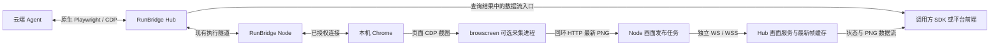

# Browscreen 可选扩展与浏览器画面流方案

状态：已确认并完成首期实施，保留实施前方案记录。核对日期：2026-10-12（Asia/Shanghai）。

0.4.0 的当前实现见[采集与分发](../architecture/浏览器画面采集与分发.md)、[接口合同](../reference/浏览器画面流接口.md)和[接入指南](../user-guide/浏览器画面流接入.md)。下文保留调研时的环境、事实、草案用语和候选路线，不将历史安装状态或待验证事项当作当前事实。

本方案中的“客户端”指 RunBridge Node，“服务端”指 RunBridge Hub。方案同时保存在两端的 `doc/design/`，本轮仅新增方案和文档导航，不修改代码、依赖、数据库或运行服务。

## 1. 结论与需求边界

可以实现。建议将 `browscreen` 作为 Node 的可选安装扩展，由 Node 管理本机采集服务，通过独立出站连接上传最新 PNG；Hub 提供对外画面数据流，并在现有查询结果中附带数据流入口与状态，由调用方负责展示。

首期行为如下，其中采集范围和 Hub 职责已由用户确认，其余内容仍属于待评审建议：

- **已确认的采集范围**：安装兼容的 `browscreen` 后，在已授权浏览器会话进入 `ACTIVE` 时自动启用；会话结束停止采集和上传。Node 仅在线或会话仅 `READY` 时不采集。
- **已确认的 Hub 职责**：Hub 负责画面数据流接口，在查询结果中一起提供接口入口；画面展示由调用方实现。
- 首期接入现有 `chrome-cdp` / `BORROWED_CHROME_CDP` 后端；受管理 Chromium 单独安排接入验证。
- 每个会话同时预览一个明确选择的标签页，多名观看者共享该画面。只有一个可截图页面时自动选择；存在多个页面时等待选择。
- 画面流采用连续 PNG，沿用 Browscreen 默认 300 毫秒采集间隔。实际频率受截图、网络和客户端解码耗时影响，不承诺视频帧率。
- 缺少扩展或扩展自身采集、上传失败时，画面接口返回明确状态，不额外中断原有执行；浏览器本身失联仍按现有规则处理。

用户已确认“仅在执行会话期间自动上传”，并要求 Hub 只提供数据流接口、将接口入口合并到查询结果中。实施时沿用当前会话的授权与结束流程。

本期不增加 Hub 展示页面、音频、历史回放、MP4 上传、浏览器远程输入或所有标签页同时采集。Browscreen 支持外部坐标合成指针，但当前 RunBridge 没有统一的坐标来源；首期不生成推测的操作指针。

## 2. 已核对的事实与证据等级

### 2.1 本地源码与分发元数据

| 事实 | 当前证据 | 对方案的影响 |
| --- | --- | --- |
| Hub/Node 当前包版本均为 0.3.0，要求 Python 3.14.x | [Hub pyproject](../../../runbridge-hub/pyproject.toml)、[Node pyproject](../../../runbridge-node/pyproject.toml) | 可选扩展需要沿用各项目 `.venv` 和现有打包方式 |
| Browscreen 本地版本为 0.3.1，要求 Python >=3.14 | [Browscreen pyproject](../../../../../SandBoxProjects/Browscreen/pyproject.toml) | 与 Node 的 Python 范围存在交集 |
| PyPI 0.3.1 元数据可读取，有 wheel 和 sdist | 2026-10-12 实际读取 [PyPI 版本元数据](https://pypi.org/pypi/browscreen/0.3.1/json)，返回 HTTP 200；[发布页](https://pypi.org/project/browscreen/0.3.1/) | 可使用公开包作为可选依赖；本轮未安装包或验证镜像同步 |
| 当前 Node 虚拟环境没有安装 browscreen | 读取 `.venv` 中的分发元数据 | 本轮没有可声称成功的 Node/Browscreen 集成运行结果 |
| Browscreen 提供最新 PNG 和帧头，也提供 webhook | [app.py](../../../../../SandBoxProjects/Browscreen/src/browscreen/app.py) 第 100–116 行；[models.py](../../../../../SandBoxProjects/Browscreen/src/browscreen/models.py) 第 79–93 行 | 可通过公开 HTTP 接口接入，不必引用采集器的内部字段 |
| webhook 不支持注册认证请求头，采集循环等待发送结束 | [webhooks.py](../../../../../SandBoxProjects/Browscreen/src/browscreen/webhooks.py) 第 14–36 行；[capture.py](../../../../../SandBoxProjects/Browscreen/src/browscreen/capture.py) 第 109–116 行 | 直接把远程 Hub 注册为 webhook 会把网络等待带入采集循环 |
| 浏览器级地址默认选择首个 page，页面级地址可精确连接 | [chrome_cdp.py](../../../../../SandBoxProjects/Browscreen/src/browscreen/adapters/chrome_cdp.py) 第 53–72 行；[使用说明](../../../../../SandBoxProjects/Browscreen/doc/user-guide/使用说明.md) | 必须由 Node 明确选择目标，避免展示错误页面 |
| Node 已有固定实例授权和每会话出站隧道 | [chrome.py](../../../runbridge-node/src/runbridge_node/chrome.py) 第 24–40、150–183 行 | 沿用本机配置、资源归属和连接代次，不允许调用方传入 CDP 地址 |
| 原生连接独占调用方位置，且 Hub 直接转发原生帧 | [sessions.py](../../../runbridge-hub/src/runbridge_hub/sessions.py) 第 215–255 行；[native.py](../../../runbridge-hub/src/runbridge_hub/native.py) 第 29–52 行 | 观看者不能占用原生调用连接，画面不能混入原生协议 |
| 当前已有节点、节点能力与会话查询接口 | [api.py](../../../runbridge-hub/src/runbridge_hub/api.py) 第 55–80 行；[protocol.py](../../../runbridge-hub/src/runbridge_hub/protocol.py) 第 99–145 行 | 在查询响应中附带画面入口与状态，扩展查询模型并同步客户端解析 |
| 控制合同使用 `extra="forbid"`，控制消息限制 64 KiB | [protocol.py](../../../runbridge-hub/src/runbridge_hub/protocol.py) 第 11–14 行；[gateway.py](../../../runbridge-hub/src/runbridge_hub/gateway.py) 第 14–44 行 | 不能随意给旧模型追加字段，也不能在控制消息中传图片 |
| 受管理模式提供 `launchServer().wsEndpoint()` | [server.mjs](../../../runbridge-node/src/runbridge_node/playwright_runtime/server.mjs)、[runtime.py](../../../runbridge-node/src/runbridge_node/runtime.py) 第 90–107 行 | 这是 Playwright 端点，不能直接交给 Chrome CDP 适配器 |

以上是源码、当前环境和公开元数据核对。依赖声明的范围可以对齐，但新 extra 的锁定、wheel 安装、CDP 双连接共存、查询扩展和数据流消费尚未实测。

### 2.2 公开协议依据

Chrome 官方协议说明列出了浏览器级与页面级 WebSocket，并说明支持多个调试客户端；这支持采用独立采集连接，但不能代替当前 Chrome/Playwright 组合的真实共存验收。[Chrome DevTools Protocol](https://chromedevtools.github.io/devtools-protocol/index.html)

Uvicorn 支持绑定已打开的套接字描述符，也支持端口 0。Node 的采集包装进程可先绑定回环地址的可用端口，再把套接字交给服务，避免固定端口和“探测空闲端口后再绑定”的竞争。[Uvicorn 配置](https://www.uvicorn.org/settings/)

## 3. 架构与接入方式



Hub 中的画面服务与原有管理、网关位于同一个单 Worker 进程，沿用内存状态；不新增 Redis、数据库图片表或独立部署服务。截图、上传、数据流订阅分别运行独立任务。对外展示和图像解码属于调用方职责。

### 3.1 为什么推荐本机采集服务

| 方式 | 优点 | 代价或限制 | 建议 |
| --- | --- | --- | --- |
| Node 管理本机 Browscreen 服务，通过 `/api/screenshot` 读取 | 复用已有公开接口、恢复状态和退出逻辑；无需修改 Browscreen | 增加一个受管理采集进程和本机 HTTP 读取 | 首期推荐 |
| Node 直接使用采集器内部对象 | 少一层本机 HTTP | 当前需依赖内部状态和生命周期，升级耦合更强 | 暂不采用；有必要时先明确公开嵌入 API |
| Browscreen webhook 直接上传 Hub | 现有 PNG 推送可复用 | 缺少认证头和会话合同；慢接收器影响采样 | 暂不采用 |

Node 使用自身 Python 环境启动一个小型包装模块，调用 Browscreen 已有 `create_app(settings=...)`。包装模块负责套接字准备、只向父进程交付本机监听地址和监督退出；不把节点凭据交给 Browscreen。父进程负责访问 Hub 的身份与上传。

包装进程同时监视父进程管道 EOF；Node 被强杀后也须触发采集服务退出，避免留下持续采集的孤儿进程。该退出机制需要真实验收，Hub 在未收到清理确认时仍保留 `UNKNOWN`。

每个活动采集实例使用 Node 创建的私有临时目录。只写该实例的 `.cdp`，不复用用户其他工具的工作目录或 `.mouse`。服务只监听回环地址，Hub 和观看端不访问用户机器上的监听端口。

### 3.2 精确选择浏览器页面

1. Node 连接 `ChromeConfig` 中已授权的固定浏览器级端点，使用只读 `Target.getTargets` 获取可截图页面。
2. 无 page 时报告等待页面；只有一个 page 时自动选择；多个 page 时通过查询结果和数据流返回本会话的目标 ID 列表，由调用方通过 API 显式选择。
3. 根据本机固定端点的主机、端口和已核对的目标 ID，生成页面级 `/devtools/page/{target_id}` 地址，写入采集实例的 `.cdp`。不接收远程提供的完整地址，不进行端口扫描或按 URL 授权。
4. 维护固定浏览器级连接的有效性；该实例失效即停止采集，不因同一端口后来出现其他浏览器而继续。
5. 切换目标时先停止旧采集实例、清空旧图，再启动新实例并分配新的 `stream_id`。选中页关闭时进入等待选择状态，不自动改截另一个页面。

目标列表只上传会话内有效的 opaque ID 和必要的显示标签，不上传调试地址、URL、Cookie 或 Profile 路径。显示标签采用普通文本输出。本草案使用“页面 1/页面 2”等标签；上传真实页面标题可作为另一个明确选择。

选择目标只决定观看哪一页，不会激活、切换或操作浏览器标签页，也不改变原有 `BROWSER_INSTANCE` 授权。原生执行协议没有提供统一的“Agent 当前页面”信号，因此首期不承诺自动跟随 Agent 切页。

## 4. 可选安装与兼容策略

### 4.1 安装行为

实施时在 Node 的 `pyproject.toml` 新增一个 extra，首期固定已核对的版本：

```toml
[project.optional-dependencies]
visual = ["browscreen==0.3.1"]
```

更新锁文件并验收后，源码安装示例为：

```bash
uv sync --locked --extra visual --python 3.14 -i http://mirrors.aliyun.com/pypi/simple/ --trusted-host mirrors.aliyun.com
```

这是拟新增 extra 的使用方式，当前项目尚不能使用该参数。基础安装不依赖 Browscreen、Pillow 或 PyAV；Hub 也不安装 Browscreen。无需 `browscreen[video]`。

Node 从自身虚拟环境检测分发版本，并由隔离的采集进程验证导入。只有安装兼容且功能初始化成功时，才声明画面能力；安装存在不等于已经产生画面。不在 Node 的基础模块顶层导入 Browscreen。

若扩展不存在，保持原有执行行为；若版本不受支持或导入失败，禁用画面扩展并报告无敏感输入的原因，不让扩展异常中断 Node 控制连接。

### 4.2 控制合同与查询响应兼容

首期维持控制合同版本 1，`Welcome`、现有控制消息和会话持久化基线保持原有结构。画面合同独立使用 `visual_protocol_version=1`。现有 HTTP 查询响应新增 `visual` 字段，采用扩展查询模型，与控制消息及持久化的 `SessionView` 分开。

- 在对应浏览器后端现有 `declared_protocols` 列表中追加 `runbridge-visual-v1`；不把 Browscreen 当成另一个可申请执行资源。
- 声明只代表支持扩展；实际 `LIVE` 由收到有效新帧确认。画面失败不把执行资源的 `readiness` 改为失败。
- 将声明挂在执行资源对应后端上，以兼容当前按许可资源过滤后端的查询逻辑。不能只增加独立 `browscreen` 后端，因为它可能被现有过滤移除。
- Node 每个控制连接代次至多探测一次 Hub 的画面支持接口，再建立独立上传连接；该步骤独立于执行准备和心跳。
- 新 Node 连接旧 Hub 时，画面支持接口返回 404 即关闭本代次画面功能，执行继续；新 Hub 面对旧 Node 或未声明扩展的 Node，返回“未声明画面扩展”。不能据此区分旧版本和未安装依赖。

本草案按“查询默认一起返回画面入口”设计，新增字段不是对所有旧查询客户端透明的变更。当前 Hub/Node 基础模型使用 `extra="forbid"`，旧客户端直接用 `NodeView` 或 `SessionView` 解析新增字段会失败；实施时须同步更新查询响应模型、Node CLI/查询函数以及使用严格模型的调用方。新查询模型将 `visual` 设为可选，使新客户端仍能解析旧 Hub 的响应；新 Hub 默认返回结构化的 `visual`。

旧 Node 的控制连接和原生执行仍按原合同工作，但它配套的旧查询客户端不保证能解析新 Hub 响应。若部署必须保留完全不升级的旧查询客户端，可另行选择 `?include=visual` 按需扩展；这会改变默认查询行为，需要在实施前明确取舍，本草案不同时引入两种模式。上层是否把 `declared_protocols` 当成固定枚举也需核验。

## 5. 查询结果与数据流接口

本节中的画面字段和画面接口均为方案，尚未实施。现有节点、节点能力及会话查询路由继续复用，统一使用 `visual` 命名。

### 5.1 在现有查询中返回数据流入口

| 已有查询接口 | 拟附带的画面数据 | 返回范围 |
| --- | --- | --- |
| `GET /v1/nodes/{node_id}` | `visual.supported` 与 `visual.streams` | 已获许可的资源能力，以及当前许可创建的活动会话数据流 |
| `GET /v1/nodes/{node_id}/capabilities` | 与节点查询保持相同响应 | 沿用当前查询别名，避免另增画面发现接口 |
| `GET /v1/sessions/{session_id}` | 本会话的 `visual` 描述 | 数据流入口、画面状态、目标列表及最新帧元数据 |

`visual.supported` 表示所查询资源声明支持画面扩展，不代表已经产生画面。节点查询中的 `streams` 仅列出当前有效许可创建、当前控制代次下处于 `ACTIVE` 的会话；其中每项包含 `session_id`、`resource_id` 和本节的画面描述。同节点的其他许可即使允许访问同一个资源，也不能看到其他许可的会话 ID、目标列表或数据流入口。

会话查询响应示例（省略原有的其他字段，数值仅为合同示例）：

```json
{
  "session_id": "session_example",
  "state": "ACTIVE",
  "visual": {
    "supported": true,
    "state": "LIVE",
    "visual_protocol_version": 1,
    "transport": "websocket",
    "content_type": "image/png",
    "stream_path": "/v1/sessions/session_example/visual/stream",
    "target_id": "target_example",
    "targets": [{"target_id": "target_example", "label": "页面 1"}],
    "stream_id": "stream_example",
    "last_frame_id": 42,
    "frame_age_ms": 80,
    "reason_code": null
  }
}
```

`stream_path` 与现有 `native_path` 使用同样的无凭据路径约定。调用方沿用已有 Hub 基址及其路径前缀拼接地址，将 HTTP/HTTPS 对应为 WS/WSS 后连接，并提交原会话访问许可。查询结果不包含访问令牌、Node 本机服务地址或 CDP 地址。

活动会话已声明画面扩展时即可提供订阅入口，处于等待页面、等待目标选择或首帧生成状态时也可连接并接收状态。未声明扩展、后端不支持、Node 离线或会话不在 `ACTIVE` 时，`stream_path` 为 null，并返回相应状态和原因；节点查询没有当前许可的活动会话时，`streams` 为空数组。`LIVE` 只能由有效且新鲜的帧确认。

查询只返回元数据和接口路径，PNG 始终通过独立数据流发送。查询响应中的画面信息由当前内存状态即时组合；不写入节点安装快照或持久化会话记录，避免保存过期入口或页面信息。

### 5.2 画面数据与管理接口

| 接口 | 调用方与用途 | 认证与约束 |
| --- | --- | --- |
| `GET /v1/nodes/{node_id}/visual/support` | Node 查询 Hub 画面合同、消息大小和默认参数 | Node 身份 Bearer；不返回页面数据 |
| `WS /v1/nodes/{node_id}/sessions/{session_id}/visual/upload` | Node 主动上传状态、目标列表和帧；接收目标选择请求 | Node 身份 Bearer + `x-runbridge-generation`；校验当前节点、代次、会话、资源和 `ACTIVE` 状态 |
| `PUT /v1/sessions/{session_id}/visual/target` | 提交 `target_id`，请求切换观看目标 | 同一许可；Node 二次核验目标；只影响画面源 |
| `WS /v1/sessions/{session_id}/visual/stream` | 连续接收状态与 PNG，允许多个只读观看者 | 同一许可；不占用原生 `caller`，不激活执行会话 |

目标切换接口立即返回 `202` 和 `request_id`，表示已受理；Node 确认后，通过数据流的选择结果消息返回同一个 `request_id` 的成功或错误，后续查询反映画面源的实际状态。`LIVE` 必须对应新目标的首个有效帧，不能把 HTTP 202 当成切换成功。

同一会话的目标切换串行处理，已有切换未完成时返回 409。受理切换即清空旧帧并冻结旧流；Node 确认目标和新 `stream_id` 后，Hub 才接受新流的图片，多名观看者仍共享同一个会话画面源。

HTTP 查询和目标管理接口沿用现有 Bearer 认证。调用方 SDK 可在 WebSocket 握手请求头认证；浏览器调用方可使用首条认证消息：5 秒内提交访问许可，成功前不发送任何目标、状态或图片，错误时关闭连接。接口路径和返回的元数据不携带凭据，服务端不记录令牌。

平台消费数据流后自行解码并展示图片，也可通过自身后端转发，沿用平台已有登录。Hub 首期只实现数据接口，不提供页面、前端静态资源或展示组件。首期不新增观看专用许可模型；无执行许可的第三方分享需要另行设计只读许可。

订阅成功后，Hub 先发送当前状态，有新鲜缓存帧时交付该帧，再发送后续状态与新帧；无图时发送等待或错误原因。会话结束后停止发送图片并关闭订阅，新订阅返回 410；认证、许可范围和不存在的会话继续使用现有错误语义。查询返回路径不代替订阅时的认证与会话有效性检查。

## 6. 帧合同、缓存与背压

### 6.1 独立画面合同

上传连接建立后先发送 `hello`，声明画面合同版本、Browscreen 版本和 PNG 格式。其后使用文本消息传递 `state`、`targets`、`select_target` 和选择结果；只允许这些画面命令，不接受任意 CDP 或网页输入。

每张图片使用一个完整二进制 WebSocket 消息：

```text
4 字节大端 JSON 长度 + UTF-8 JSON 元数据 + PNG 字节
```

建议元数据包含：

```json
{
  "visual_protocol_version": 1,
  "connection_generation": 7,
  "session_id": "session_example",
  "resource_id": "chrome",
  "stream_id": "stream_example",
  "target_id": "target_example",
  "frame_id": 42,
  "capture_started_at": "2026-10-12T12:00:00.000Z",
  "content_type": "image/png"
}
```

`connection_generation=7` 仅为合同示例。Hub 以已认证连接和真实会话为准，拒绝元数据中的归属冲突。`stream_id` 由 Node 为每次采集实例创建；Hub 为当前上传连接记录认可的流 ID，旧连接或旧目标的迟到帧不能覆盖新图。

沿用 Browscreen 的 `X-Frame-Id` 与 `X-Capture-Started-At`。每次采集服务重启或目标切换都换流 ID，允许源帧号重新从 1 开始。同流重复或倒退帧不再次发布。PNG 不放进 Base64 JSON，不进入控制连接或原生隧道。

建议首期约束：单帧 JSON 元数据最多 4 KiB，PNG 最多 4 MiB。Hub 检查包长度、合同字段、PNG 标识和大小，不在接收循环中用 Pillow 解码图片；图片实际能否解码由 Node 采集及独立数据流消费者验证。超限返回画面错误，不自动改截图尺寸或改变浏览器视口。

### 6.2 仅保留最新帧

- Node 轮询本机 `/api/screenshot`，同一源帧去重；一次只保留一张待上传帧，新帧替换旧待发帧。
- 上传发送任务和本机读取任务分开；发送超时则关闭本画面连接，在原会话仍有效时退避重连。重连清空待发数据并重新读取最新图片，不重放历史。
- Hub 每个会话只保存一张最新帧；各观看连接各保留一个最新待发引用，慢观看者不能阻塞上传接收或其他观看者。
- 正在发送的帧、WebSocket 库的有界队列和临时图片对象也计入内存预算；不声称内存中永远只有一份 PNG。
- 缓存键包含会话、连接代次、流 ID 和目标；图片与元数据整体替换，不分别读写。
- 在目标切换、源返回无图、上传断开、会话结束或控制代次失效时清空旧帧。Hub 重启不恢复截图缓存。

网络背压允许丢弃中间帧，以使数据流靠近当前状态。提供给调用方的接入说明应约定有界消费、超时与断线重连；Hub 负责数据流和背压，具体展示及图像对象生命周期由调用方管理。

### 6.3 新鲜度与画面状态

建议使用 `UNAVAILABLE`、`WAITING`、`WAITING_TARGET`、`LIVE`、`STALE`、`ERROR`、`STOPPED` 七种画面状态，并通过原因码区分未声明扩展、后端暂不支持、没有页面、采集超时、上传断开及帧过大。

Hub 用本进程的单调时钟计算接收后帧龄，默认连续 5 秒没有新帧即标记 `STALE`、清空旧图并通过数据流发布状态；查询结果同时返回该状态与帧龄。调用方按状态决定展示方式。Node 的采集时间只用于来源说明，不与 Hub 的系统时间直接相减判断时延。

Node 对本机源帧重复计时，不能反复上传同一张 PNG 来刷新 Hub 的帧龄。上传断开、采集服务返回 503 或目标关闭时，尽早发布不可用状态并清空画面。扩展状态与会话执行状态、业务结果保持分开。

## 7. 生命周期与授权

1. Node 完成现有身份、执行资源探测及能力上报；已安装扩展时，在独立任务中探测 Hub 支持。
2. 原有流程准备会话并建立原生隧道，不等待画面首帧。
3. 收到现有 `SessionConnect` 后，在本地执行激活阶段异步开启画面上传连接，交付目标列表并按选择启动采集。
4. 浏览器截图由另一个调试连接完成，不在原执行 WebSocket 上另开 `recv()` 或注入采集命令。
5. 暂时只有画面连接失效时，可在同一会话与代次下恢复；控制连接断开导致原会话终止时，必须停止采集，不能在新代次自动复活旧会话。
6. 会话释放、租期到期、许可撤销、原生连接结束及 Node 停止时，Hub 立即取消画面可见性；Node 停止读取与上传，退出自身采集进程并删除自身临时目录。

观看和选择目标均核验创建会话的 `grant_id`，不能用同节点的其他许可接管。Hub 在进入关闭状态时同步撤销上传和观看路由；每次发布也检查活动会话、当前节点连接及代次，避免仅靠连接时认证。

对外画面数据流保持只读，目标管理接口只选择画面源；接口不提供鼠标、键盘、导航或任意 CDP 请求。现有实例授权仍覆盖整个浏览器，选择单页不等于增加单标签页隔离。

借用 Chrome 时只释放自己的观察连接、执行连接和采集进程，不关闭 Chrome 或清理 Profile。正常采集错误独立报告；如果结束时无法确认 Node 自己创建的采集进程已退出，清理必须报告未确认，不能仍声称全部 `COMPLETE`。强制停止只能针对 Node 自己创建的采集进程，不能作用于借用浏览器。

## 8. 受管理 Chromium 的后续接入

受管理 Chromium 的原生端点不能直接复用为 Browscreen CDP 地址。建议在首期通路完成后做一个独立的真实运行探测，再决定最小接入方式：

| 候选 | 必须先证实的事项 | 取舍 |
| --- | --- | --- |
| 使用公开 Playwright API 实现符合 Browscreen `BrowserAdapter` 的采集适配器 | 第二个观察客户端能否看到执行客户端创建的 context/page；关闭观察客户端是否影响执行 | 可避免新增 CDP 端口，但依赖实际对象可见性和 SDK 运行时 |
| 让受管理运行时额外提供本机 CDP 入口 | 与现有 launchServer/调试 pipe 是否兼容；端点能否可靠发现和只在回环监听；不能发生端口扫描或启动参数冲突 | 更能复用现有 Chrome 适配器，但需要修改浏览器启动方式 |

两种方式均未在本轮验证。先验证“同一页面动态计数 + 并发操作 + 观察断开不结束执行”，再定实现；若都不能满足，应明确该后端画面暂不可用，不使用 Playwright 私有协议解析补齐。

## 9. 预期改动范围

| 项目 | 拟修改位置 | 目的 |
| --- | --- | --- |
| Node | `pyproject.toml`、`uv.lock` | 新增可选 extra，锁定并验证公开依赖 |
| Node | 新增 `visual.py`、`visual_worker.py` | 安装探测、目标选择、本机服务管理、独立上传及画面合同；按生命周期与工作进程职责分开 |
| Node | `chrome.py`、`client.py`，必要的执行生命周期接口 | 绑定已有授权、激活和停止流程，声明画面协议；不改原生转发规则 |
| Hub | 新增 `visual.py`、`visual_api.py` | 最新帧与订阅路由、WS 数据流、目标管理和认证 |
| 两端 | `protocol.py` 及查询模型，Hub `api.py`、`service.py`，Node 查询函数和 CLI | 查询结果附带 `visual`，按许可过滤活动流，同步严格模型解析；不扩展控制消息或持久化画面信息 |
| Hub | `app.py`、`sessions.py` | 注册画面服务，并在关闭、撤销、离线和重启时同步清理 |
| 两端 | 新增画面合同与集成测试 | 验证权限、帧归属、背压、兼容和真实页面 |
| 两端 | README、架构、接口、安装和使用说明 | 实施后说明真实支持范围及安装方法；历史方案保持原貌 |
| Browscreen | 首期无需改动 | 复用现有页面 CDP、图片接口和应用工厂；仅在后续适配验证有明确必要时修改 |

画面合同在两端独立实现并保持一致，不新增共享包或让 Hub 依赖 Node 业务代码。发布版本安排在实施和验收后确定，本草案不升版、不提交或推送代码。

## 10. 分阶段实施与成功标准

| 阶段 | 工作 | 完成标准 |
| --- | --- | --- |
| A：最小可行性探测 | 在独立临时环境安装 Browscreen；连接明确授权的测试 Chrome，运行执行与采集两条连接 | 同一页面操作及 PNG 更新均成功；采集连接退出后浏览器、登录和执行连接保留 |
| B：Node 可选扩展 | extra、本机包装进程、单页/多页选择、激活/停止及错误隔离 | 未安装路径继续通过；多页不误选；子进程、端口及文件均有明确归属和正常清理 |
| C：Hub 画面通路与查询扩展 | 独立上传协议、认证、最新帧缓存、对外数据流、现有查询附带流入口 | 查询范围和所有归属拒绝通过；慢网络不阻塞心跳/原生执行；旧帧不覆盖新目标 |
| D：真实数据流与发布验证 | 独立测试消费者、动态测试页面、多订阅者、断线与版本兼容、wheel 安装和文档更新 | 由查询入口连接并解码实际变化及正确目标；不可用时流与查询状态一致；基础/extra 两种安装都能独立运行 |
| E：受管理 Chromium | 执行上节探测，选择被实测支持的适配方式 | 先证明对象可见性或 CDP 共存，再实施；不能把候选路线写成已支持 |

阶段 A 失败时先解决连接/目标/依赖问题，不能仅用“PNG HTTP 200”证明最终需求已完成。开发和测试均使用对应项目根目录 `.venv`，通过 `uv` 管理环境；测试使用 pytest。

### 验收矩阵

| 场景 | 必须取得的证据 |
| --- | --- |
| 基础安装、未安装扩展、版本不兼容、导入失败 | 原有会话与心跳通过；画面状态真实，不出现基础包顶层导入失败 |
| 独立 wheel 安装 extra | 在独立环境安装基础包和 extra；锁文件、wheel 源码、包导入及采集包装模块均可用 |
| 查询发现与数据流订阅 | 节点和会话查询均返回合同规定的入口；独立消费者从返回路径连接，无需额外的画面发现请求 |
| 单页持续变化 | 测试页面有独立计数和颜色变化；Hub 帧号与独立消费者解码的 PNG 内容均对应页面实际变化 |
| 多标签页与目标切换 | 每页内容有不同标记；未选择时等待，选择后仅显示指定页；目标关闭、切换及新流拒绝旧帧 |
| 执行与采集共存 | 用现有官方 SDK 操作同一页面并保存实际页面状态；画面连接启动/停止不结束原生会话 |
| 未授权、不同许可、过期与撤销 | 查询不泄露其他许可的会话及流入口；目标管理和订阅均拒绝越权，已连接订阅者停止接收后续图片 |
| 旧代次、跨会话、重复与倒退帧、服务重启 | Hub 拒绝错误归属；新流允许帧号重置；帧元数据与 PNG 不交叉 |
| 慢上传、慢观看者和多个观看者 | 队列保持有界；快速观看者继续更新；原生业务操作成功，控制连接未因画面拥塞失联 |
| 图片过大、非法包、采集 503、浏览器断开 | 返回对应画面错误且及时清空旧图；扩展错误不覆盖原执行状态，浏览器失联沿用现有中断语义 |
| Node/Hub 断开、重连和重启 | 原会话不复活；缓存为空；清理状态按实际证据报告，不推断 COMPLETE |
| 消费者退出和重连 | 独立消费者断开后订阅释放，重连先收到当前状态与新鲜最新帧，不重放旧帧 |
| 查询模型与旧 Hub/Node 配对 | 新查询客户端可解析新增字段及旧 Hub 缺省字段；旧 Node 控制和执行通过，旧严格查询客户端的升级要求得到验证 |
| 借用浏览器正常退出 | 采集进程退出、回环监听结束、工作目录删除，外部 Chrome 和原登录状态仍在 |

本期默认 300 毫秒采样只用于初始配置。需要测量首帧时间、实际帧率、Node/Hub CPU、内存、PNG 大小及实际端到端延迟；端到端延迟使用统一计时的测试页面与独立观测验证，不直接相减两台机器的时钟。

## 11. 相关风险与可选优化

- 带宽随 PNG 大小、上传帧率和观看人数增长。例如每帧 200 KiB、每秒 3 帧时，单路上传约 4.9 Mbit/s；5 名观看者的 Hub 图片下行约 24.6 Mbit/s，未计协议开销。这是公式示例，不是实测吞吐。
- 同机多客户端虽有协议支持，具体 Chrome、SDK、后台页面、最小化和锁屏条件仍需验证，不能从历史截图验收推及本次组合。
- 源帧尺寸和页面复杂度会影响编码与解码；超限时先明确报错。JPEG/WebP、调整采样、按观看需求暂停上传、真正的视频编码和历史录制均可后续按实测需求选择。
- WebSocket 需要部署代理支持升级和足够的消息大小；未来多个 ASGI Worker 或 Hub 实例需要新的路由/共享状态方案。本期沿用现有单 Worker 部署。
- 当前授权是实例与执行许可；如果改成 Node 在线持续采集，或需要只读第三方分享，就会改变许可与数据可见范围，实施前必须先定对应合同。

会话期间自动上传、Hub 只提供数据流、查询一起返回流入口的范围已确认。其余方案评审重点：查询默认增加字段所需的客户端升级、首期仅支持已有 Chrome、多个页面显式选择，以及连续 PNG 的频率和带宽模型。上述技术路线已有源码依据，最终可运行与稳定性结论须在阶段 A–D 通过后确认。
