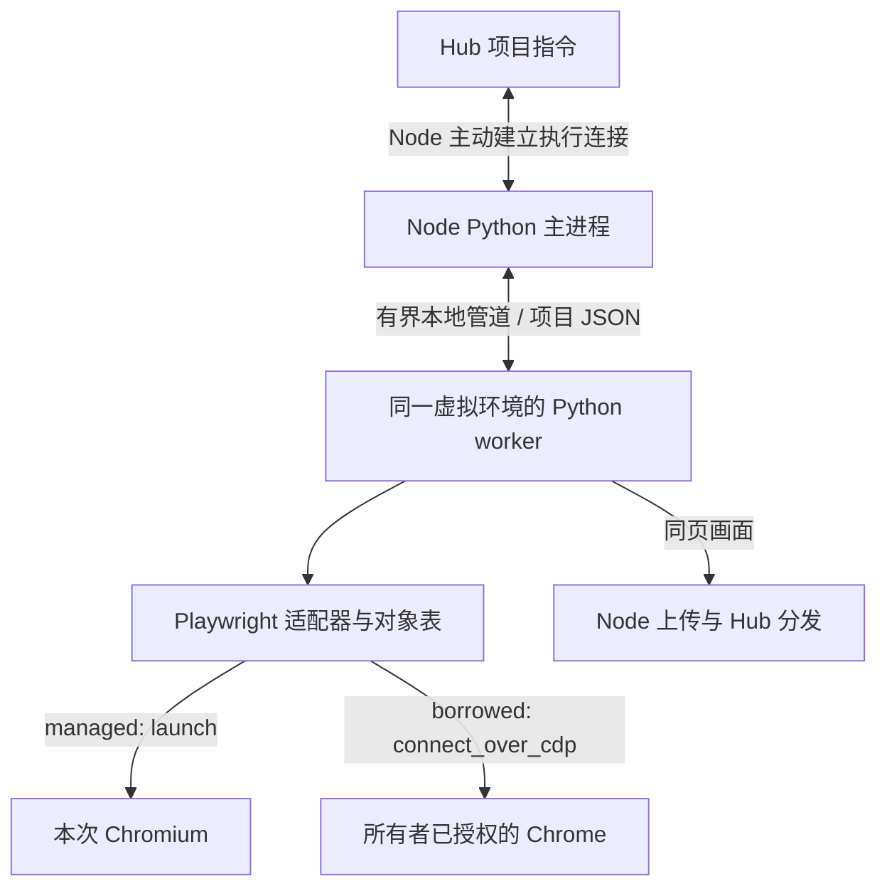

> 设计记录：0.6.0 已按本方案实施。以下保留 2026-10-18 的评审语境，正文“当前”指评审时的 0.5.x；现行字段和操作步骤以[当前文档导航](../README.md)中的手册、参考合同与架构为准。

# Python 工具执行改造方案

状态：已采纳并按 0.6.0 实施的设计记录。原评审日期：2026-10-18。当前操作以文档导航中的使用手册与参考合同为准。当前 Node 0.5.0 仍使用 npm Playwright 服务与原生隧道；本文描述拟议实现，不是当前部署步骤。

Hub 的对外 HTTP、MCP、公共信封和整体迁移顺序分别由 Hub 项目的 `doc/design/工具指令执行架构改造方案.md`、`doc/design/工具调用协议草案.md` 维护。本文件只规定 Node 的执行职责、对象、依赖、配置和验收，不包含 Hub 部署操作。

## 1. 目标与当前差异

Node 接收 Hub 已授权会话中的工具、方法、目标和参数，在本机 Python 环境调用实际工具库，并返回有类型的结果与事件。Node 对外只主动连接 Hub，不发布浏览器服务端口。

当前 [client.py](../../src/runbridge_node/client.py) 接收 session_open/connect/stop，[executor.py](../../src/runbridge_node/executor.py) 启动 [runtime.py](../../src/runbridge_node/runtime.py) 管理的 JavaScript helper，再将 Hub 隧道连到 launchServer 的本机 WebSocket。需要替换的是“原生消息转发执行路径”，身份、登记、资源独占和主动出站原则继续复用。

目标内部结构：



worker 是 Node 项目的一部分，以本节点虚拟环境的 Python 运行，例如通过 `sys.executable -m runbridge_node.worker`。它不使用系统 Node.js，不监听本机服务，不接收外部 Python 源码。Python Playwright 自带的 driver 子进程仍由该库管理，不等于需要用户另装 npm Playwright。

## 2. 主进程、worker 与适配器

### 2.1 Node 主进程

- 读取 YAML、复用已有身份、必要时登记、维持控制心跳和能力。
- 校验协议 v2、会话、当前连接代次、工具与资源的绑定关系；启动和关闭 worker。
- 维持每会话执行连接，关联 request_id，接收 worker 结果、事件和画面；不持有 SDK 对象。
- 控制连接不被操作阻塞；停止优先于普通动作队列。执行连接与画面分别使用有界缓冲。
- 记录本次拥有的进程、专用目录与清理状态。不能从 worker 已退出推断浏览器已退出。

### 2.2 Python worker

一个会话一个 worker，复用当前每会话独立 helper 的生命周期边界。首版每个浏览器资源仍只容纳一个活动会话，不借本次重构增加浏览器池或资源超卖。

worker 负责建立工具环境、创建对象、执行动作、处理页面事件和采集同一页面。stdin/stdout 采用公共协议规定的长度分帧 JSON，日志走 stderr。worker 需要持续读取停止与管理消息，不能在接收循环里直接等待长操作。

每会话一个普通执行队列，最多 16 条等待、1 条在执行。不同 Node/资源可以并行；同一会话按序操作。Playwright 调用与事件在同一 asyncio 事件循环使用，不把同一对象分配到任意线程。

输出调度优先保证结果、关闭确认和必要目录事件。画面只保留最新帧，不把每一帧排在结果之前；慢网络不得形成无限队列。

### 2.3 工具适配器

首版使用项目内的显式注册表和普通处理函数，不新增插件下载、入口点扫描或脚本解释系统。

| 入口 | 职责 |
| --- | --- |
| describe | 动作名、tool_api_version、参数/结果声明、目标类型与副作用标记 |
| probe | 验证本机工具实际可执行和资源可用，返回能力，不用已安装替代 READY |
| open | 按所有者本地配置打开资源，返回根对象及初始目录 |
| execute | 校验目标与动作参数，调用明确的 Python 处理函数，返回结果 |
| close | 按所有权释放对象、连接和资源，返回清理确认 |

公共管理器只传递协议对象，不假设每个工具都有 Page、Locator、截图或 CDP。增加其他工具时，添加对应适配器和版本化动作声明，已有传输、请求关联、租期和资源隔离不重新设计。

## 3. Playwright 的具体执行方式

### 3.1 受管理资源

1. worker 使用隔离环境启动 Python `async_playwright()`。
2. 使用本地配置调用 `chromium.launch()`，不调用 launchServer。
3. 为兼容当前 `browser_start`，建立默认 1280×720、zh-CN 的 context 和空白 page。
4. 把 Browser/Context/Page 放进本会话对象表，返回项目自己的引用和目录；后续创建、关闭和弹窗新页同步更新。
5. 解析 `tool=playwright`、`method`、`target`、`params`，调用白名单处理函数。例如 `locator.fill` 构造唯一 Locator 后执行 `await locator.fill(value=..., timeout=...)`。
6. 将原生返回值转换成普通 JSON、引用或有界二进制；不把 SDK 对象、异常实例和本地文件地址发给 Hub。

只读 DOM 检查、固定 capture 脚本、唯一定位、标签页管理和一次性弹窗策略从 Hub 迁入适配器。MCP 26 项迁移清单在 Hub 方案维护，Node 的动作目录必须逐项覆盖其执行需求。

### 3.2 对象和 Locator

对象表按 session_id 和连接代次隔离，记录类型、父对象、所有权和是否关闭。实际对象仅留在 worker。关闭 context 时失效子 page 引用；页面关闭或 worker 重启后不能继续使用旧引用。

Locator 不创建跨请求远程对象。每次根据 Page 引用和定位步骤构造，仅支持明确列出的构造方法；交互前保留唯一性检查，不能默认挑第一个匹配。iframe 必须明确 selector。拖拽同时验证源和目标所属会话。

页面创建、关闭、URL 更新、弹窗和选页事件携带递增序号发给 Hub。目录同步有缺口时通过完整会话快照刷新；不能仅依赖 Hub 旧缓存决定 Page 还存在。

### 3.3 已有 Chrome

worker 使用本地配置的浏览器级 CDP 地址调用 `connect_over_cdp(..., no_defaults=True)`，保留明确授权的 BROWSER_INSTANCE 边界和当前 URL/地址校验，不增加自动扫描或任意远程地址。

打开会话只枚举已有 context/page。复用登录使用已有 context；新 context 不会自动继承原 Profile 的登录状态。多页时由调用方选择，不能为了取得 Page 自动新开另一个浏览器。

会话释放只释放项目拥有的连接和句柄。不得关闭用户 Chrome、原 Profile 或自动关闭其原有页面；用户显式发出的 page.close 与会话自动清理区分。借用会话中明确新建而没有显式关闭的普通标签页也可能保留在用户浏览器中，不能将释放描述为“浏览器和所有标签已删除”。

借用资源的 context.close 只允许作用于本会话明确创建的隔离 context，不能关闭原有默认 context；已有页面的显式 page.close 按 BROWSER_INSTANCE 授权处理。对象表同时记录“已有”与“本会话创建”，自动清理不扩大为对用户原有对象的关闭。

已有 Chrome 的画面仍可使用现有可选采集实现，保留其兼容性范围。Node 内部维护不透明 page_id 到本机 CDP target 的映射，外部只使用项目编号；必须验证选中的画面就是执行页面。

## 4. 超时、停止、重复与清理

公共协议规定 request_id 去重、剩余预算、终态和错误格式；Node 再检查内容摘要，重复请求不再次操作页面。

Playwright 公开说明直接取消运行中的调用会产生未定义行为。因此使用 SDK 本身的 timeout，并将外部等待与内部操作任务分开。HTTP/MCP 等待结束并不代表浏览器操作停止；worker 继续维护其请求状态，不能立刻放开资源让下一操作与未完成动作并发。

会话停止经独立管理路径处理：拒绝新动作、使尚未开始的请求以 NOT_STARTED 结束、关闭受管理 browser 或释放借用连接，再等待操作和 worker 收束。关闭不能撤销已经发生的表单提交；写操作无法确认时报告 OUTCOME_UNKNOWN。

### 4.1 进程归属与异常退出是前置验证项

现有 helper 通过公开 `BrowserServer.process().pid` 提供 Chromium PID；Python `launch()` 的公开 Browser 对象没有相同 PID 接口。迁移会失去这条直接的进程管理信息，不能只替换 API 而保留原清理假设。

推荐继续用专用 worker、专用短路径临时目录和持久化活动记录建立归属边界：

- 启动前写活动记录，至少含 node_id、session_id、resource_id、worker 信息和本次临时目录；不记录 token 或完整环境。
- 正常关闭等待 Python Playwright 的公开关闭与 driver 退出，确认后删除活动记录与专用目录。
- 异常回收只允许操作已确认属于本会话的进程或目录。Chromium 可能有独立进程组，不能假定杀掉 worker 进程组一定回收全部浏览器。
- 杀死 Node/worker 后，下一次启动必须检查残留活动记录。无法确认清理则资源隔离、报告 UNKNOWN，不通过重新探测绕过旧占用。
- macOS 与 Ubuntu ARM64 需要分别验证操作系统进程归属、driver 断线退出和浏览器残留。Windows 不在此次已验证范围。

具体异常归属实现由阶段 0 的实测决定；如需要额外进程管理依赖，应在该验证后单独说明必要性。不能在方案里先宣称 Python 公共 API 已经解决强制清理。

## 5. 画面迁移

当前受管理画面在 Hub 的 ManagedCapture 中，持有 Hub 的 Page；该模块不能在 Hub 移除 SDK 后继续工作。

迁移后 worker 直接观察执行所用的 Page，通过本机公开 CDP 会话截图或 Python Playwright 截图获得 PNG；保留现有只读截图方式的同页性，是否影响执行需真实验证。Node 主进程上传原有画面格式，Hub 负责验证、保留最新帧和分发。

内部需要有界传递 frame/target/selection 信息；worker 可通过同一本地帧协议发受限图像数据，主进程转换成已有 PNG 上传格式。本地画面消息使用独立 frame 序号，不占用公共目录事件的 event_seq，也不作为目录事件转发给 Hub，避免被合并的旧帧造成目录事件缺口。画面只有一个待发送最新帧，不能堆积或阻塞结果。选择新页面、目标关闭、连接换代、采集错误和会话结束时立即撤下旧图。

画面失败不把已执行的业务动作标成失败；没有新帧继续沿用现有 STALE 规则。扩展到其他工具时，画面是可选能力，不是工具协议的必选字段。

## 6. 依赖与 YAML 迁移建议

### 6.1 依赖

- Node 保持 `uv` 管理的同一 `.venv`，增加工具 extra，例如 `runbridge-node[playwright]`，由包依赖安装 Python Playwright；首版继续使用已验证的 1.63.0，不顺带升级库。
- 不再要求用户安装系统 Node.js/npm 或独立 npm Playwright。不把 Python Playwright 自带 driver 的内部实现写成额外系统环境要求。
- 删除 `prepare-playwright` 的 npm 安装和浏览器下载行为；旧命令给明确迁移说明，不继续偷偷创建旧运行时。
- Chromium、系统库和字体仍由用户按 Playwright/系统官方说明准备。Node 运行时不自动安装工具、下载浏览器、升级浏览器或执行系统维护。
- 现有 `[visual]` 的可选画面依赖先保留，不因这次协议调整顺带替换已有 Chrome 采集技术。

### 6.2 拟议新配置

以下 YAML 仅为评审样例，当前 0.5.0 不支持；仍以配置文件所在目录作为相对路径基准，不展开 `~` 或环境变量占位符。

```yaml
# 新配置明确写版本，避免把旧 npm 运行时配置误当作有效参数。
config_version: 2
hub_url: https://hub.example.com
name: office-node
identity_file: .runbridge/node.json       # 沿用现有身份；路径默认值保持不变。
enrollment_token_file: credentials/enrollment.token  # 首次登记需要；已有身份的用法沿用原规则。

tools:
  playwright:
    resource_id: chromium                # 默认 chromium；Hub 许可绑定此编号。
    mode: managed                        # managed 或 borrowed；每个资源只能选择一种。
    # 默认 null：保留 PLAYWRIGHT_BROWSERS_PATH；未设置则用官方默认缓存。
    # 有旧独立缓存时可明确指向 .runbridge/playwright/browsers，无需重复下载。
    browser_cache_directory: null
    launch_options:
      headless: true                     # 默认 true。
      timeout: 20000                     # 浏览器启动默认 20 秒；会话整体准备上限 30 秒。
```

启动入口保留 `run --settings node.yaml`，登记与启动仍是同一步。第一版该 Playwright 配置仍发布一个浏览器资源，不新增同一身份下的浏览器池；同机多实例继续使用不同身份与 YAML。

将来其他工具放在 `tools` 的其他工具名下，由自己的 schema 解释；公共启动器不增加每种工具的一组硬编码顶层命令行参数。是否增加新的实际工具需独立需求，不随配置示例预先实现。

借用 Chrome 时用以下块替换上面的 playwright 块，不将两个块一起配置：

```yaml
tools:
  playwright:
    resource_id: chrome                  # 示例编号；沿用原许可时保留原 resource_id。
    mode: borrowed
    cdp_endpoint: ws://127.0.0.1:9222/devtools/browser/真实实例标识
    authorization_scope: BROWSER_INSTANCE  # 必须由所有者明确声明。
```

CDP 地址仍由所有者从已授权 Chrome 获取，不由服务扫描；不是 Hub 地址。borrowed 不接受 launch_options 或浏览器缓存位置等启动配置，避免把借用误写成新启动。

状态目录按身份编号放在 identity_file 所在目录的节点私有子目录中，无需用户重复填写 node_id。运行临时目录继续采用 `/tmp/rb-*` 等短路径，避免 Chromium SingletonSocket 的路径长度问题；具体平台位置由实现验证。

### 6.3 旧配置映射与冲突

| 当前字段 | 迁移 |
| --- | --- |
| 顶层 hub_url/name/identity_file/enrollment_token_file | 内容、相对路径规则、凭据来源与登记重试语义保留 |
| 顶层 playwright | 移到 tools.playwright，mode=managed |
| 顶层 chrome | 移到 tools.playwright，mode=borrowed，保留 resource_id、端点和授权范围 |
| runtime_directory | 不再作为 npm 项目位置；若需保留其 browsers 缓存，明确迁到 browser_cache_directory |
| node_executable | 删除，无需系统 Node.js 执行路径 |
| use_default_browser_cache=true | browser_cache_directory=null，保留环境与官方缓存 |
| use_default_browser_cache=false | 显式设为原 runtime_directory/browsers，不静默切换到新缓存 |
| launch_options.executablePath | executable_path |
| downloadsPath / tracesDir / artifactsDir | downloads_path / traces_dir / artifacts_dir |
| ignoreDefaultArgs / chromiumSandbox / slowMo | ignore_default_args / chromium_sandbox / slow_mo |
| args / channel / env / headless / proxy / timeout | 名称保留，按 Python 参数模型校验 |

当前安装的 Python Playwright 1.63.0 的公开 launch 签名已核对包含上述 snake_case 字段。改名、路径和浏览器兼容仍需实施时做目标环境验证。

旧 JSON、旧 YAML 不能静默忽略移除字段。建议提供只读取旧配置、输出迁移预览的开发/迁移步骤，人工核对后保存为新文件；不原地覆盖，不删除 npm 目录、浏览器缓存、身份或 token。迁移过程不重新登记另一个 Node ID。

## 7. 预计源码改动

以下为待实施范围，本次没有改动源码、依赖、配置或运行环境。

| 区域 | 改动方向 |
| --- | --- |
| protocol.py / client.py | v2 消息与连接、工具能力、会话初始目录、停止优先 |
| executor.py | 原生 WS pump 改为项目指令调度与 Python worker 管理 |
| runtime.py / playwright_runtime | 移除 npm helper，替换为 Python worker 生命周期与环境 |
| 新增 tools/playwright / worker 模块 | 对象表、明确方法、Locator、固定采集、对话框与结果转换 |
| chrome.py | 不再向 Hub 转发原始 CDP；保留本机授权和 Python 借用适配 |
| startup.py / cli.py | v2 tools 配置、迁移提示，沿用身份与登记入口 |
| visual*.py | 管理浏览器同页画面与已有 Chrome 映射、独立有界上传 |
| pyproject.toml / 锁文件 | Playwright 成为显式工具 extra；保留核心与可选 visual 的职责 |
| tests / 文档与样例 | 项目动作合同替换原生 SDK 接入，保留业务效果和清理验证 |

不修改浏览器安装目录、全局 uv、系统 Node.js 或既有测试环境。实施验收使用全新目录和虚拟环境，旧材料按前后快照核对。

## 8. 验收顺序

1. 先证明 Python worker 正常和异常退出的所有权与清理，再确认可采用本方案的进程边界。
2. 最小纵向链路：本机 Hub → 虚拟机 Node → Node Python `launch()` → 表单填写和提交 → 实际页面或业务记录。
3. 完整动作覆盖：Hub 当前 26 项 MCP 的执行需求、HTTP 的显式对象操作、文件上传真实内容、PNG 解码与页面采集。
4. 交互事件：弹窗前置策略、新页目录、iframe、目标关闭、同页画面和多页切换。
5. 可靠性：重复 ID、不同内容冲突、排队超时、收到操作但结果丢失、Hub/Node/worker 断线、停止、撤销和到期；不可盲目重放写操作。
6. 借用 Chrome：保留已登录状态、既有进程和原页面；释放与用户显式关页分开验证。
7. 同机两个身份：对象、请求、临时目录和画面互不串用；仍不允许两个身份发布同一实际 Chrome。
8. 新发行物在全新 `.venv` 通过工具 extra 安装；不依赖 npm 项目、旧缓存路径、源码导入或 Hub 内的 Playwright。

Node 的协议静态校验、worker 单测、真实本机浏览器和真实虚拟机业务闭环是不同验证层次，记录中分别说明。现阶段只做源码和设计核对，没有执行新架构验收。

## 9. 官方依据

- [Python 异步库用法与任务取消限制](https://playwright.dev/python/docs/library)。
- [BrowserType 的 launch 与 connect_over_cdp](https://playwright.dev/python/docs/api/class-browsertype)。
- [Dialog 事件与 accept/dismiss 要求](https://playwright.dev/python/docs/api/class-dialog)。

官方 API 支持上述调用方式，不等于已经证明该 Node 的强制清理、不同平台和完整工具合同通过验证。
