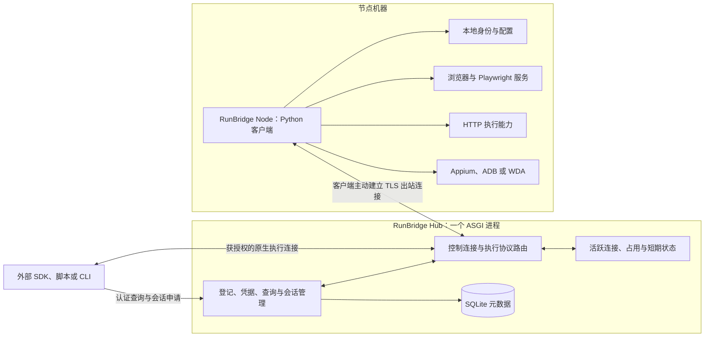

> 历史方案：描述 0.5.x 或更早阶段，保留当时决策语境。当前 0.6.0 已改用 Python worker；请从[当前文档导航](../README.md)操作，不照本文旧命令部署。

# RunBridge 范围与架构

[文档导航](../README.md)

## 1. 目标与范围

RunBridge 提供独立可用的远程自动化节点服务：RunBridge Node 向 RunBridge Hub 自行登记，所有者授予访问凭据，外部调用方查询节点能力，再使用获授权的执行资源。下文以 Hub 指代服务端，以 Node 指代客户端；通用的“节点”仍表示登记的机器及其资源。

当前范围：节点注册、身份、访问凭据、资源发现、连接网关、会话路由、客户端和执行工具接入。外部业务编排、模型调用、测试用例管理和业务报告不在范围内。

首期范围与部署选择已由用户确认：管理与网关分模块、单实例单 ASGI Worker、SQLite 与内存；容量按 100 用户、10 并发执行规划，每名用户暂按 1 个在线客户端估算。R0/R1、受管理 Chromium 与 R4 Chrome 复用已实施，见[R4 验收](../project/R4Chrome复用验收记录.md)；容量仍未压测，具体条件见[最小实现与验证计划](最小实现与验证计划.md)。

保持原生执行能力与参数是设计原则。服务不要求调用者采用某一套自然语言工具，也不要求提交调用方的业务实体标识。

## 2. 三部分职责

| 部分 | 负责 | 状态归属 |
| --- | --- | --- |
| RunBridge Hub：节点控制管理 | 登记、凭据、授权、资源目录、占用规则、会话元数据、查询 | 持久登记与运行规则 |
| RunBridge Hub：节点网关 | 接受客户端连接、验证连接身份、路由执行流、背压、连接关闭和事件 | 活跃连接与即时路由 |
| RunBridge Node：节点客户端 | 本机身份、资源探测、主动出站连接、执行进程启动/附着、输出及清理 | 本机实际资源和驱动状态 |

管理和网关首期属于 RunBridge Hub 同一个进程的两个模块；RunBridge Node 是运行在节点机器上的独立进程。浏览器、Appium、ADB 和 WDA 由 Node 管理或连接，不运行在 Hub 管理进程中。

数据库保存连接的登记信息，不保存活 WebSocket、浏览器对象或任务协程。所有节点状态都必须区分“持久记录”和“当前观测”。

## 3. 控制连接与执行连接

首期客户端维持一条控制连接，用于身份确认、心跳、能力更新、会话准备和停止。需要原生执行流时，按会话建立单独的出站隧道，避免截图/录屏或大量协议事件阻塞管理消息。

| 通道 | 内容 | 处理方式 |
| --- | --- | --- |
| 控制面 | 登记、状态、会话准备/关闭 | Pydantic 验证的结构化消息 |
| Playwright 执行面 | 原生 WebSocket 命令、响应和事件 | 保留顺序、文本/二进制类型和协议语义 |
| Appium 执行面 | HTTP 方法、路径、请求体、状态码与响应 | 代理原生请求，关联会话和授权资源 |
| 输出 | 协议已传输的数据，或额外附件 | 原生传输优先；额外文件用授权资源引用 |

首期控制连接与执行连接分离，执行数据使用有界缓冲和背压，不能使控制消息长期无法处理。HTTP 转接方式和具体缓冲参数在原型中落实并验证；不将每个 HTTP 请求都视为新的独立执行会话。首期不承诺完整重实现所有浏览器协议；优先使用对应工具已经支持的远程协议。

## 4. 最小生命周期

1. 客户端准备本机身份，使用部署方允许的登记方式接入服务器。
2. 服务器保存稳定节点 ID 和节点身份验证信息；重连不得覆盖其他节点身份。
3. 节点所有者生成外部访问凭据，服务器保存验证信息及授权范围。
4. 客户端报告工具版本、可用资源及当前状态。
5. 调用方认证查询并申请使用资源；服务器和客户端确认资源可用。
6. 客户端启动或附着执行服务，网关提供对应受保护入口。
7. 调用方使用原生协议；结束、撤销或失联时按会话规则释放资源。

节点登记凭据用于证明客户端身份，外部访问凭据用于证明调用许可。两者分别管理，不用同一个秘密同时代表所有权限。首期可使用部署配置与本地 CLI，不要求建设账户中心或复杂授权体系。

## 5. 运行状态

节点：离线、准备、在线、停用。资源：待探测、待本机授权、可用、占用、失联待确认。会话：准备中、运行中、关闭中、已关闭、异常中断、待协调。

“节点在线”不等于某个浏览器或手机可运行；“网关收到响应”也不等于某个业务动作符合调用者预期。服务只提供技术状态、原生结果和错误。

查询能力和成功占用资源是两个步骤。首期可在单进程用资源级锁和会话记录串行申请；客户端再次检查真实资源，不根据数据库中的旧状态直接宣布成功。

## 6. 重启和失联

服务器重启后，SQLite 中的节点、凭据和撤销记录仍存在；活连接消失，在线状态先重置。客户端重新认证并重新报告资源，不恢复旧 WebSocket 对象。

之前运行中的会话标记为失联或待协调。客户端报告执行进程与实际资源后，按合同停止或明确重新附着。首期优先采用“旧连接失效、重新申请资源”，不承诺透明恢复原生 SDK 对象。

客户端遇到控制连接失联或授权到期，停止接受新会话。自建测试资源可按约定回收；借用的已有浏览器只解除本次控制，不随意关闭用户原有程序。超时和关闭都不会回滚已发生的外部操作。

## 7. 拆分和扩容边界

管理与网关分模块即可满足首期职责清晰。只有连接吞吐、独立升级或多实例路由提出实际要求，才考虑分进程/分服务；届时需要补充网关归属、内部认证、路由、资源协调和故障处理，详见[管理网关与存储选型](管理网关与存储选型.md)。
