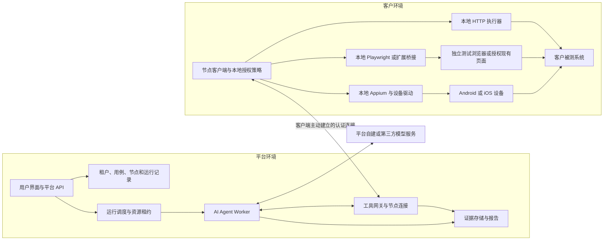
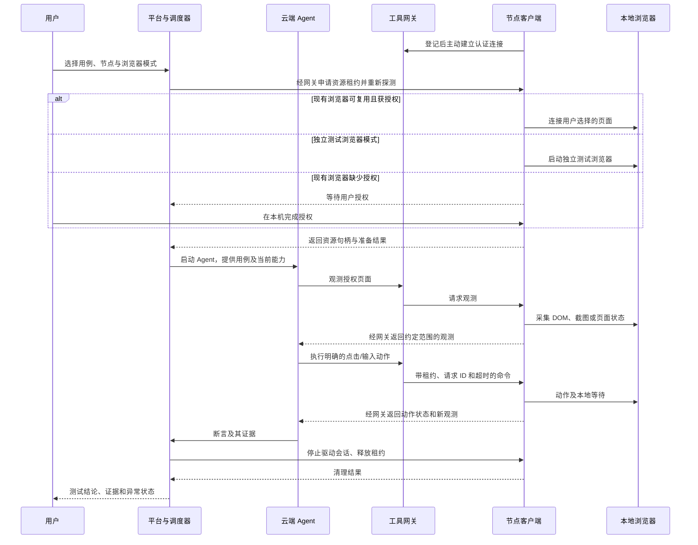

# 平台与执行节点架构

[文档导航](../README.md) · [可行性与方案取舍](可行性与方案取舍.md)

本文件保留早期由平台统一注册、分配节点和管理消息的建议设计，不代表已实施。最新建议把节点控制、网关和客户端拆成独立服务，见[独立节点服务与对外契约](独立节点服务与对外契约.md)。本文件中的平台租户、运行 ID 和统一上传目标不再作为独立节点接口的必选要求。

## 1. 组件与职责

模型服务画在独立节点，是因为部署可能位于平台内部，也可能是第三方 API。客户的观测回传政策需要覆盖这一跳。

| 组件 | 职责 | 不应混入的职责 |
| --- | --- | --- |
| 管理 API | 用户、项目、用例、节点、报告和权限 | 长时间占用 HTTP 请求等待 Agent 完成 |
| 调度器 | 匹配节点、配额、排队、租约、取消 | 根据“最近在线”直接认定资源可用 |
| Agent Worker | 用例理解、规划、模型调用、工具选择、业务判断 | 直接获得其他租户的节点连接和密钥 |
| 工具网关 | 根据认证上下文找到节点，检查范围，关联响应和事件 | 信任 Agent 自报的租户 ID，或向公网裸露调试端口 |
| 节点客户端 | 出站连接、能力探测、本地策略、驱动生命周期和日志 | AI 决策循环、平台模型密钥、任意主机命令执行 |
| 本地执行器 | 明确动作、等待、观测与超时 | 任意下载并执行云端生成的脚本 |
| 证据与报告 | 保存观测来源、断言、错误和清理状态 | 将“工具成功”自动转换为“业务 PASS” |

上述逻辑职责初期可以位于同一个平台服务和同一个节点程序中。不需要一开始拆成多个微服务。平台管理 API、异步 Agent Worker 和节点连接处理应能独立管理生命周期；数据库与证据存储优先沿用已有技术栈。

## 2. 节点登记和授权

建议流程：

1. 用户在平台创建节点登记请求，得到短时、一次性配对码。
2. 客户端向平台兑换节点身份，显示账户、组织和有效授权范围；用户确认。
3. 客户端保存节点凭据，主动建立 TLS 连接；平台依据凭据绑定租户，不依据消息正文决定租户。
4. 客户端报告 OS、版本、协议版本及已启用的执行能力；浏览器标签页和手机只登记用户选择的范围。
5. 节点保持心跳，资源状态随连接、插拔和授权变化更新。用户可在本机停止连接，在平台撤销节点。

建议节点凭据和运行授权分开：前者证明“这台客户端属于谁”，后者限定“本次运行能操作什么”。注册电脑不会自动获得浏览器扩展、Android USB 调试或 iOS 信任权限。

能力快照包括：

| 类型 | 建议字段 | 不能据此推断的事实 |
| --- | --- | --- |
| 主机 | OS、架构、客户端版本、交互会话状态、探测时间 | 主机未来不会休眠或断网 |
| Web | 引擎、版本、受管理/扩展/原生确认模式、授权资源句柄 | 所有打开页面都允许访问；业务登录仍有效 |
| API | 指定测试服务的连通结果、代理/CA/凭据引用是否可用 | 客户内网全部可访问或可被扫描 |
| 移动 | 选定设备的匿名资源 ID、OS、驱动版本、调试/WDA 状态 | 设备已解锁、所有 App 可观测 |
| 资源 | 并发槽位、当前租约、权限状态、观测新鲜度 | 一个节点等同一个槽位 |

资源目录使用平台分配的逻辑 ID；原始设备序列号、本地路径和 Profile 路径默认留在节点。平台拿到的是可使用资源和准备状态，不是客户电脑的完整资产清单。

## 3. 调度与运行前准备

初期仅支持显式选择节点和资源，减少自动匹配的不确定性。后续再加入按浏览器版本、设备类型和项目标签筛选。

开始运行前要同时满足：当前用户有权使用节点、节点在线、工具协议兼容、资源健康、权限符合要求、资源没有冲突租约。准备阶段重新探测，不直接复用注册时的成功结论。

租约粒度建议：独立测试浏览器按实例；复用浏览器按授权会话并考虑整个 Profile 的共享状态；手机按设备独占。两条 WSS 连接或两个 Chrome 窗口不能隔离同一账号的 Cookie 和服务端业务状态。

用例运行固定 `run_id` 和用例版本；每次重新尝试分配 `attempt_id`，不得悄悄覆盖上一次失败或未知结果。

## 4. 一次 Web 用例的调用链

用户明确选择复用模式时，缺少授权不能静默改为新开空白浏览器，因为这会改变登录状态和测试前提。

## 5. 通信与工具协议

推荐以 WSS 出站连接作为交互式节点的首个实现。企业环境若阻断 WebSocket，可验证基于 HTTPS 的任务拉取/长轮询方案；后者是工具 RPC 的替代传输，需要保留响应关联、事件顺序和取消语义，不能承诺透明替换任何 CDP 流。

Agent 调用工具网关可以采用 MCP Streamable HTTP 或项目已有工具接口。节点上的 Playwright MCP 可作为受保护子进程运行，节点客户端代理其工具调用。标准 MCP 本身不提供跨租户节点登记、资源租约和持久运行恢复。[MCP 标准传输及自定义传输边界](https://modelcontextprotocol.io/specification/2025-11-25/basic/transports)

建议首批工具：

| 领域 | 工具示例 | 执行位置 |
| --- | --- | --- |
| 资源 | `resource.prepare`、`resource.inspect`、`resource.release` | 本机；租约由平台与本机共同确认 |
| Web | `web.observe`、`web.navigate`、`web.click`、`web.fill`、`web.wait` | 本地 Playwright/扩展 |
| API | `http.request`，使用本地凭据引用 | 本地 HTTP 客户端 |
| App | `app.observe`、`app.tap`、`app.input`、`app.swipe` | 本地 Appium 与驱动 |
| 文件 | `artifact.upload`、`artifact.read`，限定已授权文件/输出 | 本机进行路径和大小校验 |

自然语言交给云端 Agent；节点接收明确动作。如果向节点发送“自己判断并完成付款”这样的开放目标，就已经把部分规划或自主决策移到了客户端。

每条命令至少关联 `run_id`、`attempt_id`、`command_id`、`resource_id`、租约代次、序号、截止/超时和本地授权范围。租约代次用于拒绝旧 Worker 的迟到命令。字段定义见[命令示例](../../examples/执行命令示例.json)。

结果至少区分：接受、执行中、执行完成、拒绝、失败、超时，以及外部效果是否已知。DOM 元素引用或截图坐标附带观测版本；页面变化或用户手动干预后重新观察，避免使用过期定位信息。

大图片、录屏和附件可以通过绑定租户与运行的短期上传地址传输，控制通道只回传引用。上传目标由平台确定，节点不接受 Agent 任意指定的外发地址。

## 6. 断线、取消和重复命令

| 事件 | 推荐行为 |
| --- | --- |
| 命令尚未被节点接受就断线 | 等待连接恢复或到期；不能宣称已执行 |
| 已点击“提交”，响应回平台前断线 | 查询本地命令记录及业务状态；未确认时记为 `OUTCOME_UNKNOWN` |
| 收到同一 `command_id` | 返回已有记录，不直接重放有副作用动作 |
| 同一 ID 携带不同命令正文 | 拒绝，避免重复 ID 改变执行含义 |
| 用户取消 | 本机撤销待执行命令、尽力停止驱动操作并清理；已发生的业务写入不会自动回滚 |
| 平台 Worker 崩溃 | 租约到期后节点停止接受新动作；恢复时先协调旧命令状态 |
| 用户撤销本地授权 | 立即停止接受该范围的新命令；平台显示权限已撤销 |
| 节点程序崩溃 | 重启后按持久命令记录协调；不能根据网关超时自动重做提交 |

应在执行前持久登记命令，在动作完成后记录结果。即便有本地去重记录，客户端仍可能在“业务写入已完成、结果尚未记录”的窗口崩溃，无法对任意 UI 操作保证 exactly-once。未知结果要通过业务查询或人工确认解决。

本地租约使用节点计时器执行有效期，不仅依赖平台和客户电脑墙上时钟一致。资源重新分配前应确认前一执行器停止，或者完成受管理实例的隔离/回收；租约失效不能自动消除正在执行的浏览器或设备动作。

## 7. 状态与证据

建议把状态分开保存：

- 执行状态：排队、准备、运行、等待用户、断连协调、取消中、结束。
- 测试结论：`PASS`、`FAIL`、`INCONCLUSIVE`。
- 外部效果：`NOT_APPLIED`、`APPLIED`、`OUTCOME_UNKNOWN`。
- 清理状态：未开始、完成、部分完成、失败。

例如“点击请求成功，但订单是否创建未知”应是执行记录存在、业务结论不确定、外部效果未知；不能展示绿色通过。报告提供断言依据、截图/响应、节点和工具版本、观测时间、错误链及清理结果。

对本地可信度也要保持边界：客户可控制自己的执行器及环境，平台不能仅凭节点自报就证明截图和响应未被修改。对于需要强审计的测试，增加被测服务日志或业务查询作为独立证据；不要把节点身份认证当作测试事实认证。
