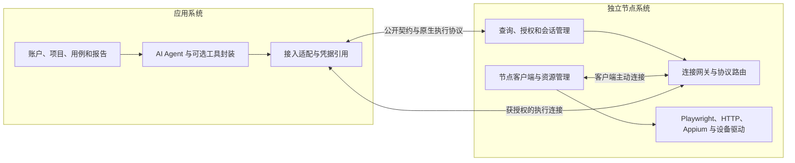

# 独立节点服务与对外契约

[文档导航](../README.md) · [自研边界与中间件选择](自研边界与中间件选择.md)

本文件评估最新提出的拆分方式，是当前研究建议：应用平台与 Agent 构成一部分，节点控制、网关和客户端构成独立部分，通过公开契约接入。没有开始代码实施，也没有完成原生协议代理的运行验证。

## 1. 结论

**这种拆分合理，适合作为独立的远程自动化节点服务。** 节点服务可以自行注册节点、探测能力、管理资源和执行会话，不需要理解测试用例、平台账户或 Agent 的规划。平台只保存服务地址、节点标识和凭据引用，查询能力并发起执行。

对接凭据、查询接口、能力文档是接入的三个核心部分。还需少量通用执行约定：协议/工具版本、会话和资源归属、超时与断连、文件/事件及错误返回。这些属于任何远程调用都需要的行为，不要求两个系统共享业务代码、数据库或内部状态机。

不建议把平台的 `tenant_id`、`case_id`、`run_id`、`attempt_id` 变成节点接口必填参数。节点使用自己的 `node_id`、资源标识、访问凭据和会话标识；调用方可提供一个可选关联字段，具体含义由调用方决定。

## 2. 两部分的职责



| 责任 | 应用系统 | 节点系统 |
| --- | --- | --- |
| 用户、项目、用例和业务权限 | 自行管理 | 无须认识这些业务实体 |
| 节点注册和接入网关 | 保存对接信息 | 自行完成注册、认证、连接和路由 |
| 节点访问许可 | 使用节点所有者授予的凭据 | 验证凭据和资源范围，支持撤销 |
| 资源占用 | 选择资源并请求使用 | 判定可用性、独占或并发规则 |
| 工具执行 | 使用原生客户端或自行封装 | 提供实际工具能力和会话生命周期 |
| AI 准备和规划 | 自行实现 | 不参与模型决策 |
| 动作结果 | 使用结果和错误继续决策 | 保留底层结果、错误、事件和必要执行状态 |
| 用例 PASS/FAIL | 根据业务预期判断 | 不负责定义业务测试结论 |
| 附件和证据归档 | 按产品需要保存 | 提供可获取的输出；无需预绑定平台存储 |

两个系统可以分别运行和发布。节点服务可以被测试平台、普通脚本、CLI 或其他 Agent 使用；平台也可替换节点服务，只要接入适配遵循对应契约。

## 3. 对接码：可以简单，但要定义准确

### 3.1 持有凭据与调用者身份

节点生成访问码、只有持码者可以使用该节点，是可行的访问许可方式。其含义是“持有码者获得对应权限”，不自动证明是哪一个平台、用户或组织。Bearer token 的核心性质就是持有即可访问，不要求另行证明密钥所有权。[RFC 6750](https://www.rfc-editor.org/rfc/rfc6750.html)

如果当前只需要节点所有者授权一个调用方，可以直接使用足够长的随机访问凭据，不必先做 OAuth、复杂角色体系或共享 SaaS 账户。使用 TLS，凭据绑定节点和资源范围，节点所有者可以撤销或更换即可。

节点客户端向自己的网关登记时，也要有该系统内部的节点身份验证。调用方持有访问码，与网关确认“这条连接确实属于该节点”是两个不同方向的认证，均由节点系统自行管理。

### 3.2 两种对接码不能混用

| 形式 | 用途 | 建议约定 |
| --- | --- | --- |
| 短期易输入配对码 | 用户手工建立接入关系 | 短时有效、限制尝试次数、兑换后失效；换成后续访问凭据 |
| 长期随机访问凭据 | API/SDK 自动调用 | 安全随机生成、足够长、绑定范围、支持撤销/轮换 |

不必同时实现两种。首期直接由节点所有者生成和交付随机访问凭据，是较简单的方案。不能把几位易猜数字作为长期公开接口的唯一秘密。

平台应把凭据放在自己的连接配置或密钥存储中，由接入层添加认证信息。Agent 可以知道节点 ID 和工具能力，无需在提示词中看到真实访问码。接口日志和 CLI 输出也不应默认打印凭据。

调用方还需确认节点服务地址和预期节点 ID。访问码用于服务端验证调用许可，不能单独替代调用方对服务地址/TLS 身份的确认。

## 4. 查询接口：描述能力，同时报告当前状态

接口和 CLI 都可以提供，但建议使用同一份数据模型。API 返回结构化内容；CLI 的机器模式将结构化结果输出到 stdout，将诊断输出到 stderr。下面名称仅为接口提案：

```text
GET /v1/nodes/{node_id}
GET /v1/nodes/{node_id}/capabilities
GET /v1/sessions/{session_id}

nodectl inspect <node-id> --output json
```

所有实际资源查询验证对应凭据；调用方只能看到其获准查询的节点和资源。CLI 通过安全凭据配置调用接口，不要求把秘密直接写在命令行参数中。

| 信息 | 最小内容 | 作用 |
| --- | --- | --- |
| 节点身份与连接 | 节点 ID、在线状态、最近观察时间 | 判断当前连接及信息是否过期 |
| 协议版本 | 节点管理接口版本、可用原生协议 | 决定接入方式和兼容性 |
| 工具版本 | Playwright、浏览器、Appium、驱动/插件版本 | 匹配客户端与执行环境 |
| 资源 | 可访问的浏览器/设备、当前占用及准备状态 | 选择已有资源或申请新资源 |
| 授权条件 | 需要连接确认、设备调试授权、资源范围 | 决定是否等待人工准备 |
| 能力覆盖 | 接入模式、支持范围、明确限制、文档版本 | 避免误把部分桥接当成完整原生能力 |

建议区分静态能力与动态状态。例如“安装了 Appium”是静态能力，“手机已授权且空闲”是当前状态。节点在线不能证明浏览器仍可操作；浏览器已连接不能证明业务账号已登录。

业务登录是否有效通常由平台/Agent 查询被测系统来判断。节点可以提供 Cookie、页面等底层观测能力，但不需要硬编码每个业务系统的登录判断规则。

查询只是快照。真正取得设备或已有浏览器会话时，由节点服务原子确认占用状态；即使首期只支持单调用者，也应明确冲突时返回忙碌，而不是两个调用方同时操纵同一手机。无需因此先建设复杂分布式调度。

## 5. 工具能力：优先保留原生 API 与参数

你的第三项建议合理。节点服务不需要预先把能力收窄成 `web.click`、`app.tap` 等少量方便 Agent 使用的工具，也不需要自行解释自然语言。能力文档应对应真实工具版本；语义封装由平台或 Agent 的实现者决定。

建议将接口分成管理面与执行面：

- 管理面：节点查询、访问许可、资源占用、会话状态和输出获取。
- 执行面：Playwright 原生远程连接、Appium 原生 HTTP/WebDriver 与驱动扩展，或明确描述的其他原生能力。

两类接口的区分是为了职责清晰，不要求分成两个部署服务。

### 5.1 Playwright：复用远程协议比重写每个 API 更合适

Playwright 的公开 API 包含 Browser、BrowserContext、Page、Locator 等对象，以及事件和回调。仅仅提供 `method + JSON 参数`，无法直接保留对象链、事件、函数传递、文件和生命周期的完整语义。[Browser API](https://playwright.dev/docs/api/class-browser)、[Locator API](https://playwright.dev/docs/api/class-locator)

对于受管理的测试浏览器，建议优先评估：节点通过 `launchServer()` 创建浏览器服务，网关提供受保护的协议路由，调用方通过官方 `connect()` 得到远程浏览器对象。这样调用方仍使用熟悉的官方 API，不需要节点服务维护一套逐方法复制的 SDK。

官方要求连接方与启动方 Playwright 主次版本匹配；这是兼容性合同，和两个产品共享业务代码无关。[BrowserType 远程连接](https://playwright.dev/docs/api/class-browsertype)

调用示例仅说明 API 形态，假定节点系统已提供授权端点，未实际执行：

```javascript
const browser = await chromium.connect(endpoint, {
  headers: { Authorization: credentialHeader }
});
const context = await browser.newContext();
const page = await context.newPage();
await page.getByRole('button', { name: '提交' }).click({ timeout: 10000 });
```

这段代码属于调用方，运行在平台/Agent 环境；浏览器位于节点。浏览器启动参数、资源分配和调用前授权由节点系统完成。不能将本地 `chromium.launch()` 的所有行为默认为可以不经适配直接发生在远程节点。

已有浏览器的 CDP/扩展接入需单独声明覆盖范围。CDP 仅适用 Chromium，官方说明其兼容程度低于 Playwright 原生连接；扩展也可能缺少某些浏览器级能力。参数尽量保持原样，但不能把未实现功能静默丢弃后仍宣称完整 Playwright 支持。

### 5.2 Appium：保留原生 HTTP 路由与驱动扩展

Appium 本来就有 HTTP/WebDriver 会话、元素标识、能力参数和扩展协议。可让网关代理原生路径、请求与结果，调用方使用官方或兼容客户端；不必重新定义一套 `tap`/`swipe` 的必选封装。[WebDriver Protocol](https://appium.io/docs/en/latest/reference/api/webdriver/)、[Appium Protocol](https://appium.io/docs/en/latest/reference/api/appium/)

会话能力、Appium 参数、动作与驱动扩展应尽量保留；节点系统检查是否落在授权设备和实际支持范围。设备分配与原生 `POST /session` 的关系必须明确，避免管理层先创建 Appium session，官方客户端随后又创建一个，造成重复会话和资源冲突。

官方 Appium 会限制部分高权限功能，客户端不能改变服务端的开关。能力查询应公布实际允许的范围，遇到限制保留明确错误。这是节点所有者与驱动的约束，不是为了方便 Agent 而删减 API。[Appium Server Security](https://appium.io/docs/en/latest/guides/security/)

### 5.3 文档和机器描述

文档可以负责解释能力、参数和示例；轻量能力清单负责告诉调用方“哪个版本、哪个协议、哪些资源和限制当前有效”。不必先把所有 Playwright API 转成自有 OpenAPI，也不必要求所有调用方使用 MCP。

对于自有管理接口，保持稳定 JSON 格式和版本即可。对于原生执行面，直接引用匹配版本的官方 API；补充节点系统引入的认证、路由、文件位置和资源限制。若采用自研 RPC，则必须逐项定义对象引用、事件、回调、返回值和错误，维护成本会明显增加。

## 6. 三项接入约定之外的最小运行合同

| 约定 | 为什么需要 | 最小处理 |
| --- | --- | --- |
| 版本兼容 | 官方 API 和协议不是任意版本混用 | 查询返回版本，接入前检查，错误明确 |
| 资源和会话归属 | 手机、现有浏览器不能被相互冲突的调用操纵 | 节点决定独占/并发，返回会话或原生协议关联 |
| 关闭与清理 | 自建浏览器与用户原有浏览器的生命周期不同 | 区分创建、借用、断开和关闭，明确到期行为 |
| 超时与断连 | 超时可能发生在实际动作完成之后 | 返回连接/执行状态；调用方不据超时自动重放业务写入 |
| 事件与输出 | 下载、录屏、弹窗和截图不是普通 JSON 数值 | 使用原生事件/传输，补充输出获取与文件位置说明 |
| 错误分层 | 凭据、节点离线、能力不足和驱动错误原因不同 | 保留原生错误，单独标记节点服务错误 |

通用 request/session 标识可以帮助关联日志。平台业务运行 ID 不是节点系统必需概念。纯原生协议转接也未必能给每个调用提供持久命令账本；应如实声明，只提供连接/会话状态时，不承诺动作级恢复或 exactly-once。

节点服务可以承诺“请求已接受”“驱动返回”“连接中断”等技术事实，不应仅凭收到点击请求宣称订单已经创建。应用系统负责核对业务结果。取消、释放和断开连接也不等于已发生的业务写入被回滚。

文件输出不应依赖特定平台的对象存储。原生协议已经传输内容时保留其行为；需要额外获取输出时，节点提供可授权获取的字节或资源引用，调用方自行归档。明确 SDK 的文件写入究竟发生在哪一端，避免把节点路径当作平台本地路径。

## 7. 最小接入过程

1. 用户独立安装节点客户端，将其登记到节点服务，完成所选浏览器/设备的本地准备。
2. 节点所有者生成访问凭据，交给调用方；调用方保存地址、节点 ID 和凭据引用。
3. 调用方查询当前能力、工具版本和可用资源。
4. 节点系统确认资源使用权，提供原生执行端点或明确的远程工具入口。
5. 调用方使用对应 SDK；Agent 是否需要简化工具、自然语言解释或业务断言，由调用方自行实现。
6. 调用方结束或断连时，节点按公开的资源生命周期约定处理。

如果一台手机已经被占用，另一个持有有效码的调用方仍可能收到忙碌；如果访问码正确但浏览器尚未授权连接，仍可能需要用户准备。凭据有效与资源可运行是不同条件。

## 8. 验证拆分是否成立

- 无测试平台参与，普通脚本或 CLI 能独立查询、建立执行连接并操作获准资源。
- 更换一个平台/Agent，实现者只需对接公开接口和对应版本 SDK，无需读节点内部数据库或继承平台业务模型。
- 管理节点时不要求提交用例、租户或 Agent 专属字段。
- 验证官方 API 的代表性能力：Locator 链与参数、浏览器事件、上传/下载、Appium capabilities/actions/扩展与原生错误。
- 验证访问码的错误、节点绑定、撤销和资源冲突，不能只测一个正确码的正常流程。
- 验证断线、对象/会话失效、释放和借用资源清理；不通过“连接恢复”推断业务动作没有重复或没有发生。

建议验收重点从“两个模块能互相调用”提升为“节点服务独立可用，并且原生能力和远程行为有明确合同”。无需为了这种独立性预先增加其他业务功能。
