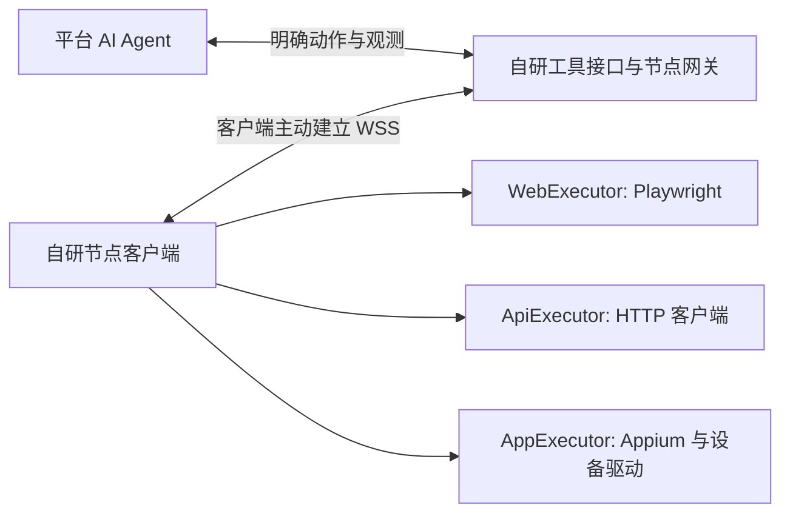

# 自研边界与中间件选择

[文档导航](../README.md) · [类似产品与开源选型](类似产品与开源选型.md)

本文件补充讨论“平台和客户端是否适合自行开发”。结论属于设计建议，不表示已经确认实施，也没有开始开发产品代码。

后续对拆分边界的建议见[独立节点服务与对外契约](独立节点服务与对外契约.md)：平台与 Agent、节点控制服务分别开发，通过公开协议对接；本文少量 `web.click`/`app.tap` 工具是调用方可选封装，不是节点系统的必选能力集合。

## 1. 推荐结论

**建议自行开发 SaaS 业务核心、云端 Agent 调用逻辑、节点接入与控制协议、节点客户端及执行器适配，直接使用 Playwright、HTTP 客户端和 Appium/设备驱动作为执行基础。** 数据库、传输库、消息系统或流程引擎根据实际需要复用成熟组件。

前一版列出的产品和框架用途不同：有些用于证明产品形态，有些可作为局部适配，有些是执行 SDK。它们不需要整体成为你的产品运行时。对于这套需求，把其他完整 Agent 产品嵌入为核心，可能引入多余的规划、状态和权限体系。

尚未找到可完整覆盖需求的测试节点中间件，不能据此推断所有中间件都不存在或都不适合直接使用。缺少的是与你的租户、授权、资源与测试语义一致的整套控制层。

## 2. 自研范围怎样划分

| 层 | 推荐处理 | 原因 |
| --- | --- | --- |
| SaaS 管理 | 自研或沿用已有平台 | 账户、组织、用例、项目和报告属于业务核心 |
| 云端 Agent | 自研业务编排和工具调用，复用模型 SDK | 用例理解、准备、执行、断言和修复需要符合产品定义 |
| 节点控制层 | 自研 | 节点身份、连接、资源匹配、租约、命令记录、权限与取消是核心合同 |
| 节点客户端 | 自研 | 探测环境、管理本地资源、运行执行器和提供停止入口 |
| Web 执行适配 | 自研薄适配，调用 Playwright | 驱动启动、定位、等待和常规观测由成熟 SDK 提供 |
| API 执行适配 | 自研薄适配，调用 HTTP 库 | 处理本地网络、代理、CA 和凭据引用 |
| App 执行适配 | 自研薄适配，调用 Appium/驱动和 ADB | 移动 UI 自动化与设备连接复用成熟实现 |
| 数据与传输 | 复用数据库、WebSocket/gRPC 库；按需要使用消息/流程中间件 | 不重新实现数据库、网络协议和通用持久化机制 |
| 浏览器现有会话桥接 | 单独评审 | 可以使用现成授权桥接，也可以自研扩展与适配；不是 Playwright 本身自动解决 |

SDK 接口可以直接使用；“其他完整产品不适合作为核心”不等于其每个基础组件只能参考思路。是否引入某一工具，取决于它能否承担边界清晰的职责，并允许平台掌握权限和运行状态。

## 3. 直接复用的中间件有哪些

| 候选 | 可以直接承担的职责 | 不能代替的职责 | 当前建议 |
| --- | --- | --- | --- |
| WebSocket 库 + 自研网关 | 长连接、双向消息和节点出站接入 | 节点登记、资源会话、授权、持久命令状态 | **优先用于最小原型**，新增组件较少 |
| [gRPC 双向流](https://grpc.io/docs/what-is-grpc/core-concepts/) | 类型明确的 RPC 和双向消息流 | 重连后的业务协调、资源租约与测试结果判定 | 团队已有 gRPC 时可以选，不必为了原型引入 |
| [NATS](https://docs.nats.io/learn/core-nats/) / [JetStream](https://docs.nats.io/concepts/jetstream) | Request-reply、发布订阅、持久消息 | 设备授权、任务与资源归属、执行副作用去重 | 多个网关/Worker 需要统一消息路由时评估 |
| [Temporal](https://docs.temporal.io/workers) | 工作流状态协调、任务队列、超时及重试编排 | 浏览器/设备控制、节点授权、客户资源隔离 | 长任务和恢复逻辑达到复杂程度后评估 |
| [frp](https://github.com/fatedier/frp) | 反向代理、NAT 后服务连接 | 工具协议、租户权限、任务和会话生命周期 | 需要原生调试协议转接时使用，不作为工具 RPC 的必需项 |

gRPC 官方提供双向流；NATS 官方提供消息模式，且能通过 WebSocket 接入。这些都是可以直接复用的基础，不是“只能看源码参考”的完整 AI 测试工具。[NATS WebSocket](https://docs.nats.io/learn/websocket/)

本次补充查证了上述组件的官方能力，未做部署、组合安装或许可证/依赖清单审计。这里没有承诺任意企业代理都允许相应传输。

### 3.1 NATS 的适用位置

建议优先考虑放在平台内部：Agent Worker → 消息系统 → 对应节点网关 → 客户节点。这样客户只面对受控的平台接入协议。也可设计客户直接使用 NATS，但需要额外定义客户端凭据、允许主题和租户隔离，并验证部署网络。

Core NATS 的消息仅发给当时在线的订阅者，是 at-most-once；JetStream 提供持久化及 at-least-once。持久化能避免消息丢失，却不证明浏览器点击只发生一次。命令过期、旧租约检查和本地去重依然需要平台开发。

不要把离线期间积压的“点击”“提交”在节点重连后直接重放；旧页面、旧观测或旧授权已经可能失效。等待执行的用例与必须在当前会话执行的动作，应具有不同有效期和调度语义。

### 3.2 Temporal 的适用位置

可以把平台端用例生命周期做成 Workflow，具体操作做成 Activity。平台 Workflow/Agent Worker 留在平台，Activity 可以通过网关调用节点；也可以让节点运行专门的 Activity Worker，但会增加客户端对框架、任务队列和权限模型的耦合。

Temporal Server 本身协调状态并提供任务，业务代码由开发者的 Worker 执行。因此，选择 Temporal 并不等于把云端 Agent 交付给用户。[Temporal Worker 定义](https://docs.temporal.io/workers)

官方明确 Activity 在允许重试时可能多次执行，业务写入应具备幂等性。对任意网页的“提交”不能假定重试安全；未知结果需要查询或人工协调。[Activity 幂等与重试](https://docs.temporal.io/activity-definition)

对当前原型，一个持久运行状态机、节点网关和现有任务队列即可开始。只有当长时间等待、恢复、跨阶段协调的复杂度证明需要流程引擎时，再选择 Temporal。

## 4. Playwright、ADB 与 Appium 的分工

| 执行目标 | 建议基础 | 分工 |
| --- | --- | --- |
| Web | Playwright | 页面定位、输入、点击、等待、DOM/截图和浏览器会话 |
| API | HTTP 客户端 | 在节点 DNS/代理/TLS 环境发请求，使用本地凭据 |
| Android 设备管理 | ADB | 连接/授权检查、安装、文件和必要诊断；原始截图/input 操作可作为底层能力 |
| Android App UI | Appium UiAutomator2 | UI 元素、会话、动作和等待，底层也使用 Android 工具 |
| iOS App UI | Appium XCUITest/WDA | iOS 的 UI 操作和会话；不使用 ADB，准备路径按场景文档验证 |

UiAutomator2 官方说明其操作分别通过 UiAutomator2 server、ADB 及辅助组件实现，所以 ADB 与 Appium 不是简单的二选一关系。[UiAutomator2](https://github.com/appium/appium-uiautomator2-driver)

如果 Android 只需截图、坐标点击、滑动和输入，可先采用 ADB 的有限动作集，但 UI 树采集、元素定位、等待、应用状态和兼容性需要自己补齐。若目标包含稳定元素定位和系统化 App 测试，建议先使用 Appium，把开发投入放在产品控制层。

现有浏览器复用仍需要可连接的入口。Playwright 能连接已提供控制端点的浏览器，但不能根据“电脑中存在 Chrome 进程”直接获得控制权。独立测试浏览器可直接由节点 Playwright 管理；用户日常浏览器则另选授权扩展/原生确认，或开发自己的桥接。[Playwright BrowserType](https://playwright.dev/docs/api/class-browsertype)

## 5. 推荐的调用链和最小接口

Agent 调用 `web.observe`、`web.click`、`http.request`、`app.observe`、`app.tap` 等自有工具。节点将这些操作映射到实际 SDK。定位等待、短期动作重试和观测采集留在本机；业务规划、下一步选择和最终判断留在平台。

短期动作重试仅用于驱动确认允许且不会重复业务效果的情况，例如等待元素可见；“提交后没有返回”不属于可以自动重放的普通等待失败。

平台可以将工具适配成 MCP，但对于只有自家 Agent 使用的首期系统，直接函数调用加自有类型协议也可满足需求。**MCP 不需要成为平台和节点之间的必选传输。** 节点不必安装完整 Playwright MCP、Midscene 或 browser-use Agent。

工具参数应明确，避免把“判断页面并自行完成所有步骤”的开放目标发送给节点。现有 Agent SDK 如果硬性要求云端持有 Playwright/CDP 对象，则需评估 SDK 适配或协议转接，不将远程工具当成透明本地对象。

## 6. 自研必须解决的工作量

执行 SDK 已解决浏览器和设备的许多细节。产品自研投入主要在：

1. 节点注册、凭据更新、连接归属和本机停止。
2. 能力探测、运行准备、浏览器/手机资源独占。
3. 命令关联、授权范围、超时、取消和迟到命令拒绝。
4. 断线后的业务结果核对、观测刷新和清理。
5. 可追溯的断言与证据，以及节点和工具版本兼容。

建议首先验证一个内网 API、一个受管理浏览器、一个已登录现有页面和一台 Android。每个动作“能调用到 SDK”只是起点；授权撤销、用户手动干预、提交后断线和业务验证才决定产品能否稳定使用。

基于当前需求，最合适的首期组合是 **自研业务与节点控制 + 现有数据库/任务队列 + WSS 库 + Playwright/HTTP/Appium**。NATS、Temporal、frp 都保留明确的引入条件，不需要同时加入首期架构。
