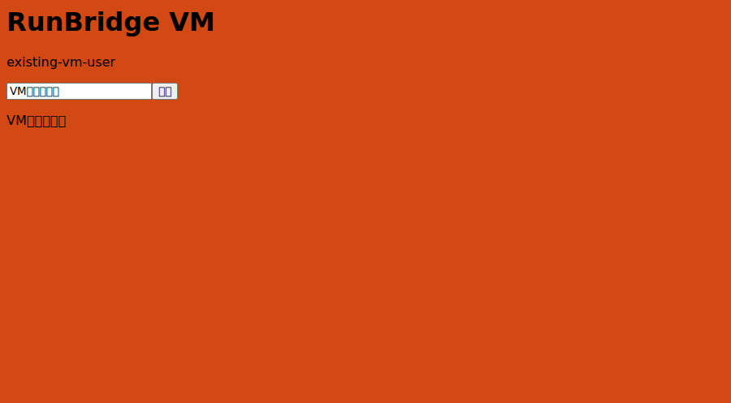
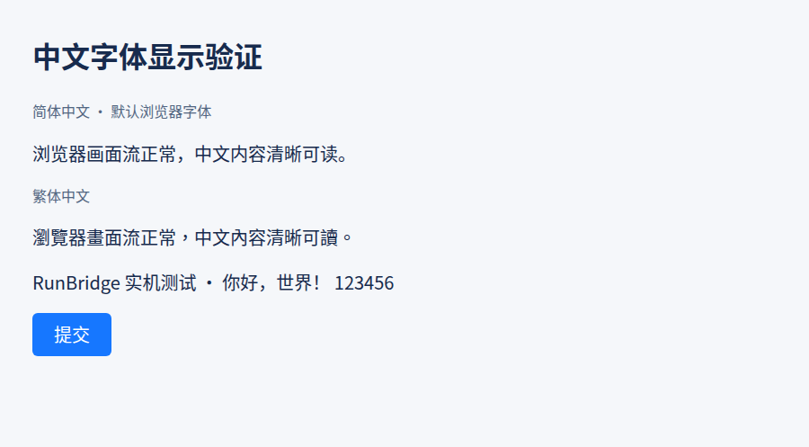

# 虚拟机 Node 跨机器验收记录

[文档导航](../README.md) · [画面接口](../reference/浏览器画面流接口.md) · [接入指南](../user-guide/浏览器画面流接入.md)

2026-10-13（Asia/Shanghai），按用户授权通过 SSH 连接 pegasus@192.168.20.129，在虚拟机运行 Node，在本机运行 Hub。**实际业务与画面链路通过**。本次使用借用 CDP 模式，浏览器由测试所有者启动，Node 不拥有浏览器进程或 Profile。

## 环境与部署

| 位置 | 实际环境 |
| --- | --- |
| 本机 Hub | macOS arm64、Python 3.14.7、runbridge-hub 0.4.0 |
| 虚拟机 Node | Ubuntu 26.04.1 LTS aarch64、Python 3.14.4、runbridge-node 0.4.0、Browscreen 0.3.1、Pillow 12.3.0 |
| 虚拟机浏览器 | 现有 Playwright 缓存中的 Chromium 153.0.8010.12；新建独立 Profile，以 headless 模式运行 |
| 网络 | Hub http://192.168.20.1:49762；虚拟机直接连接网桥地址，无 SSH 端口转发 |

Node 安装目录为 /home/pegasus/runbridge-visual-test-20261012-171400，虚拟环境位于该目录的 .venv。uv 0.13.0 使用[官方隔离安装方式](https://docs.astral.sh/uv/reference/installer/)放在 tools 中，未改 shell 配置；依赖通过 uv 安装，使用约定的阿里云镜像。复用已存在的 ARM64 浏览器缓存，检查其依赖完整，未安装系统包或修改日常 Profile。

本机 Hub 使用独立目录 /private/tmp/runbridge-vm-test-20261013-011904、随机端口、登记凭据和 SQLite，未使用其他已有服务的数据。访问凭据保存在该目录的 access.json，目录及文件为私有权限，不在文档中展示凭据值。

## 取得的实机证据

- 虚拟机直接访问本机 health 返回 200；节点在线，实际上报 Linux/aarch64/Python 3.14.4 和 chrome-cdp 画面能力。
- Node 仅在线及会话 READY 时没有采集进程；本机 Playwright 1.63.0 通过 Hub 连接后进入 ACTIVE，查询提供实际 stream_path。
- 本机 SDK 在虚拟机回环 HTTP 页面操作已有登录，填写并提交“VM跨机器实测”，DOM 结果正确；释放后通过虚拟机独立 CDP 连接再次核验结果、登录、localStorage 和 Cookie 摘要。
- 两个独立消费者读取同一流，Pillow 解码为 900×497，目标 ID 对应原页面，实际像素从蓝色变为橙色，帧号 2 → 3。记录帧为 10,713 字节；从本机 SDK 发起改色请求到本机消费者解码匹配画面为 0.260 秒。这是本次局域网短场景的观察值，不是容量或延迟保证。
- 无许可查询返回 401；同资源的另一个许可无法查询或订阅该会话，返回 403，节点流目录也不暴露该会话。
- 消费者断开后原生页面仍可操作；正常结束确认 COMPLETE，采集进程退出，原浏览器和登录保留。
- 强杀本次测试 Node 后，旧 SDK 断开，旧会话为 INTERRUPTED/UNKNOWN/OUTCOME_UNKNOWN，流入口撤下。Linux 上独立观察到采集进程退出、临时目录删除、监听端口关闭；未据此改写 Hub 的 UNKNOWN。
- 从同一私有配置重启 Node，连接代次 1 → 2，新会话正常 READY 并释放为 COMPLETE。最终节点 ONLINE、资源 READY/FREE、streams=[]，没有持续画面采集。

VM 安装目录中的 15 个包源码文件与上传 wheel 逐字节匹配，两端服务日志未发现凭据、本机 CDP 地址泄露或未处理异常。完整机器与运行事实见[核验 JSON](../reference/虚拟机跨机器运行核验记录.json)。

## 画面与支持边界

以下 PNG 直接来自 Node → Hub → 本机消费者的数据流：



首次验收时，虚拟机 fc-list 的中文字体查询为空，所以以上原始截图中的中文显示为方框。DOM 输入和业务结果的 UTF-8 文本核验通过；首次验收未改动系统字体。后续补齐字体的结果见下节，原始截图与核验 JSON 保留首次验收事实。

本轮验证的是这一 Ubuntu/ARM64/Chromium 组合和局域网直连。受管理 Chromium 画面、其他 Linux 组合、Windows、公网 TLS/代理、锁屏和长期容量仍没有由本轮得到支持结论。

## 中文字体补齐

2026-10-13 08:18（Asia/Shanghai），按用户要求为虚拟机 pegasus 用户安装 Noto CJK。字体包来自 Ubuntu 官方镜像，版本为 fonts-noto-cjk 1:20240730+repack1-1build1，SHA-256 与虚拟机 APT 元数据一致。虚拟机原代理和软件源直连下载均不可用，本次在本机下载并校验，再通过 SSH 传入；未改原代理配置。

四个常规／粗体 Sans、Serif 字体文件位于 /home/pegasus/.local/share/fonts/noto-cjk；同时将包内的语言匹配规则放入 /home/pegasus/.config/fontconfig/conf.d/70-fonts-noto-cjk.conf，并刷新用户字体缓存。这是用户级安装，不依赖 sudo，也没有登记为系统 APT 已安装包。

原 Chromium 使用旧字体缓存，重启独立测试浏览器和 Node 后生效。保留了原 Profile、业务页地址、登录 Cookie 和 localStorage。重启恢复的重复测试标签页已关闭，保留原目标；Hub 继续使用原地址和数据目录。

- 声明 zh-CN、zh-TW 的验证页分别实际使用 Noto Sans CJK SC、TC；简体、繁体、中英文混排与按钮文字均已通过截图核验。
- 本机 SDK 在原业务页填写并提交“中文字体正常显示：你好，世界！”，实际使用 Noto CJK 字形。Node → Hub 画面流收到并独立解码 900×497、17,075 字节的 PNG，目标对应原测试标签页，中文内容清晰可读。
- 会话结束为 COMPLETE，当前 Node ONLINE，连接代次为 4；无活动流或采集进程。Hub、Node 和独立浏览器继续运行。

完整安装与运行事实见[中文字体核验 JSON](../reference/虚拟机中文字体核验记录.json)，实际数据流图片见[中文画面流截图](../reference/虚拟机中文画面流截图.png)。下图为浏览器字体验证页的截图：



## 保留的测试服务

验收会话均已结束，当前保留本机 Hub、虚拟机 Node、独立测试浏览器和回环业务页运行，便于继续使用。安装目录与测试 Profile 保留；不会因单纯在线而采集。

在本机 runbridge-node 项目目录查询当前节点：

```bash
uv run --locked --no-sync runbridge-node inspect node_8e9f477e09344fbdbcbe498e6e88c059 --access-file /private/tmp/runbridge-vm-test-20261013-011904/access.json
```

申请执行会话时使用 resource_id=vm-chrome 和 client_version=1.63.0，再按 Chrome 指南用官方 SDK 激活原生连接。查询中的画面入口只在 ACTIVE 期间可订阅。对接许可有到期时间；到期后应在虚拟机通过 Node grant 重新签发私有对接文件。

虚拟机进程信息在安装目录的 node-runtime.json、owner-runtime.json，本机 Hub 信息在独立目录的 hub-runtime.json。停止时只按这些文件处理本次测试进程，不使用宽泛进程匹配，也不删除其他浏览器、目录或安装。

停止本次测试部署的脚本已核验进程归属。可在本机项目目录运行（保留安装和记录）：

```bash
uv run --locked --no-sync python /private/tmp/runbridge-vm-test-20261013-011904/stop-services.py
```
