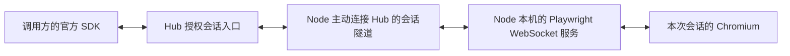

# Node 受管理 Chromium：选择运行时并启动

[文档导航](../README.md) · [返回部署步骤](../deployment/部署与运行.md) · [配置参数](../reference/部署配置与凭据.md)

适用于 Node 0.5.0。每次会话创建新 Chromium 并在结束后回收；不复用日常浏览器的 Profile。开始前完成部署第 1～5 节，已安装本程序、收到登记文本并保存 `node.yaml`；不必事先执行登记命令。

## 1. 运行环境要求与管理边界

| 环境 | 本项目要求 | 安装与维护 |
| --- | --- | --- |
| Node.js | >=20，并使用官方仍支持的版本；常驻进程能找到 `node` 或配置实际路径 | [Node.js 官网](https://nodejs.org/en/download)、[支持周期](https://nodejs.org/en/about/previous-releases) |
| npm | 仅准备 npm Playwright 时需要；正常运行使用已准备的模块 | [npm 官方说明](https://docs.npmjs.com/downloading-and-installing-node-js-and-npm) |
| npm Playwright | 本版运行时要求 **1.63.0**，含 `node_modules/playwright` | [Playwright 官方安装](https://playwright.dev/docs/intro) |
| Chromium 和系统库 | 与该 Playwright 版本对应的浏览器、目标操作系统所需库；有窗口模式还需图形会话 | [Playwright 浏览器与系统依赖](https://playwright.dev/docs/browsers) |
| 字体 | 能覆盖实际页面语言，由浏览器所属用户使用 | 操作系统官方文档／设备管理员 |

Node.js 的 `node` 与本项目 Python 命令 `runbridge-node` 不同。上述基础环境由用户或管理员准备，本项目不负责安装、升级或配置它们。

启动前确认所选 Node.js 的 `--version` 能正常返回；命令路径存在不代表其动态库和运行环境完整。准备工具还要求所选环境中的 `npm --version` 正常。

### 为什么使用 launchServer，与 Python launch 有什么差别

受管理模式要解决的是：浏览器运行在 Node 设备上，另一台机器上的调用方仍能使用官方 Playwright SDK 操作它。因此，除了启动浏览器，还需要一个能接收远程 SDK 指令、返回结果和事件的服务，以及连接这个服务的地址。

| 启动方式 | 得到什么 | 另一进程如何接入 |
| --- | --- | --- |
| Python `chromium.launch()` | 当前 Python 进程持有的 `Browser` 对象，可直接在该进程中操作浏览器 | 这次调用不提供供另一 SDK 进程连接的 Playwright WebSocket 服务地址 |
| Node.js `chromium.launchServer()` | 启动浏览器和 Playwright 协议服务，返回 `BrowserServer`；其 `wsEndpoint()` 给出服务的 WebSocket 地址 | 另一进程的 SDK 使用 `chromium.connect()` 连接该服务，再取得操作远程浏览器的 `Browser` 对象 |

**RunBridge 真正需要的是持续运行的协议服务及其连接地址。**例如，`wsEndpoint()` 可能返回 `ws://127.0.0.1:54321/随机路径`，端口和路径由运行时产生。这个地址指向 Playwright 的控制服务；它不是被访问网页的 URL，也不是 Chrome 的 CDP 调试地址。浏览器进程 ID 用于进程管理，版本号用于兼容性检查，两者都不能代替这个连接地址。`launch()` 返回的 `Browser` 则是当前进程中的 SDK 对象，不能把对象内容交给另一台机器就继续使用其中的活动连接。接口区别见 [launchServer 官方说明](https://playwright.dev/docs/api/class-browsertype#browser-type-launch-server)和 [wsEndpoint 官方说明](https://playwright.dev/docs/api/class-browserserver#browser-server-ws-endpoint)。

这里的“Playwright 原生协议”就是官方 SDK 与 Playwright 服务之间传递操作指令、对象标识、返回结果和事件的通信格式。例如，调用方执行 `page.goto(...)`，SDK 将操作转换成协议消息；Node 设备上的 Playwright 服务接收消息、驱动 Chromium，并将完成结果或错误发回。`Browser`、`Context`、`Page` 对象之间的关系及页面事件也通过这条连接同步。这样调用方就能继续使用官方 SDK，Hub 无需逐个实现导航、点击等自动化接口。

本项目通过以下路径双向转发这些消息：



`launchServer()` 的服务只监听 Node 设备的 `127.0.0.1`。Node 主动建立到 Hub 的会话隧道，并在本机把隧道中的消息转发给该服务。远程调用方连接的是 Hub 提供的 `/v1/sessions/{session_id}/playwright` 会话入口，经过授权和转发后到达该服务。因此，调用方无需访问 Node 的本机地址，部署者也无需收集或手填随机端口和路径。操作结果、错误和浏览器事件沿原路返回。

**项目支持 Python Playwright。**Python 调用方通过 `chromium.connect()` 取得控制上述远程浏览器的 `Browser`，Hub 的 MCP 工具内部也使用 Python SDK。需要 npm Playwright 的是 Node 设备上负责提供协议服务的这一环：当前 Python 公开 API 没有对应的 `launch_server()`，用 Python `launch()` 替换后，只启动了可由该 Python 进程操作的浏览器，还缺少供远程 SDK 接入的服务。要采用这种替代方案，仍须另外提供协议服务，或由项目另写远程操作接口和对象、事件转发机制。当前实现选择官方 `launchServer()` 提供的现成服务。它与浏览器插件无关，也不会把任意已打开的 Chrome 转成这种服务。

调用方与服务的 Playwright 主版本和次版本须匹配，例如本版 npm Playwright 1.63.0 对应 Python Playwright 1.63.x，见 [Python 官方连接说明](https://playwright.dev/python/docs/api/class-browsertype#browser-type-connect)。

如果目标是复用**已有 Chrome**，选[Chrome 复用模式](Chrome复用快速开始.md)：转发 Chrome 自身提供的 CDP 调试入口，Python 调用方使用 `connect_over_cdp()`。这条路线不使用 `launchServer()`，Node 设备也不需要 Node.js/npm Playwright。CDP 是 Chromium 的调试协议，与上述 Playwright 服务使用的协议不同；官方说明通过 CDP 连接的能力覆盖低于 `connect()`，部分高级功能可能不能正常使用，因此当前两种模式分别提供，见[官方 CDP 说明](https://playwright.dev/python/docs/api/class-browsertype#browser-type-connect-over-cdp)。

## 2. 运行时准备方式只选一种

### A. 已有运行时，或自行按官网准备

可以直接复用已有的 npm Playwright **1.63.0**。将其 npm 项目根目录填入下一节 `runtime_directory`：该目录中应有 `package.json` 和 `node_modules/playwright/`。这不是全局 `node` 可执行文件的位置，也不是 Python 的 site-packages。

浏览器按同版 [Playwright 官方浏览器说明](https://playwright.dev/docs/browsers)准备。采用其默认浏览器缓存时，将 `use_default_browser_cache` 设为 `true`；用户自己设置的 `PLAYWRIGHT_BROWSERS_PATH` 也会保留。安装浏览器和启动 Node 必须使用可访问同一缓存的系统用户和环境。已有兼容浏览器无需重复下载。

这条路线不要求执行 `prepare-playwright`，Node 启动时也不会执行 npm 安装、更新依赖或下载浏览器。若浏览器在自定义位置，还可使用配置参考中的 `launch_options.executablePath` 或 `channel`，兼容性由用户在目标环境核验。

### B. 选择项目提供的独立运行时准备工具

需要为这次部署建立独立 npm 项目和浏览器缓存时，可在部署目录执行：

```bash
cd ~/runbridge-node
.venv/bin/runbridge-node prepare-playwright --runtime-dir .runbridge/playwright --node-executable node
```

它按包内锁文件安装 npm Playwright 1.63.0，并调用官方安装器下载 Chromium 到该目录的 `browsers/`；不会安装 Node.js、系统库或字体。需要 npm、Node.js、网络及目录写权限。已存在不同依赖文件时拒绝覆盖，使用新目录。

这条命令的价值是固定已验证版本、隔离依赖与浏览器缓存、避免误改其他部署。**这是可选便利工具，不是原生协议的强制步骤。**已有或自行维护的符合要求的运行时同样可用。

## 3. 浏览器设置放进同一个 node.yaml

完成 B 时，在部署第 5 节的 `node.yaml` 中增加下面一段；已有 `chrome` 段时先移除它，不能同时选择两种浏览器：

```yaml
playwright:
  launch_options:
    headless: true
```

默认值已对应 B 的 `.runbridge/playwright`、`node` 命令、`chromium` 资源 ID 和独立 `browsers/` 缓存。不需要抄录浏览器版本、进程 ID、动态端口或另存 `playwright.json`。

完成 A、运行时位于 `/srv/browser-runtime` 并使用官方默认缓存时，改用下面的 `playwright` 段，不要把两段同时复制：

```yaml
playwright:
  runtime_directory: /srv/browser-runtime
  use_default_browser_cache: true
  launch_options:
    headless: true
```

`/srv/browser-runtime` 要改成你实际准备的 npm 项目目录。Node.js 不在服务 PATH 中时，在 `playwright` 内补 `node_executable: /实际路径/bin/node`。这些是本机运行位置，不是调用方的路径。

完整可复制文件见 [Node 启动 YAML](../reference/examples/Node启动配置.yaml)，所有字段、路径基准和旧 JSON 兼容方式见配置参考。

## 4. 用同一条命令登记并启动

```bash
cd ~/runbridge-node
.venv/bin/runbridge-node run --settings node.yaml
```

首次启动自动创建 0600 权限的身份文件，向配置中的 Hub 登记，然后连接和上报能力；正常应先见“节点登记完成”，再见“节点在线”。不要手写 Node ID 或身份令牌。

如果登记失败，保留生成的身份，修复错误后执行同一启动命令；会复用同一个 ID 和令牌重试，不会新建另一节点。保留登记文件配置时，每次进程启动都会做一次幂等登记，重连不重复登记。确认首次成功后，可以从 YAML 中移除 `enrollment_token_file`，之后仅凭原身份启动；环境中也不再提供登记令牌即可。

终端保持运行。浏览器实际探测失败时 Node 可能已在线，但资源不可用，要按官方要求核对运行时、浏览器缓存和系统环境；本程序不会在启动时自动修复或安装它们。

返回[部署指南第 7 节](../deployment/部署与运行.md#7-检查状态并向调用方交付访问文件)，在新终端签发许可，确认 ONLINE、READY/FREE，再交付调用方。结束时先释放会话再正常停止 Node。
