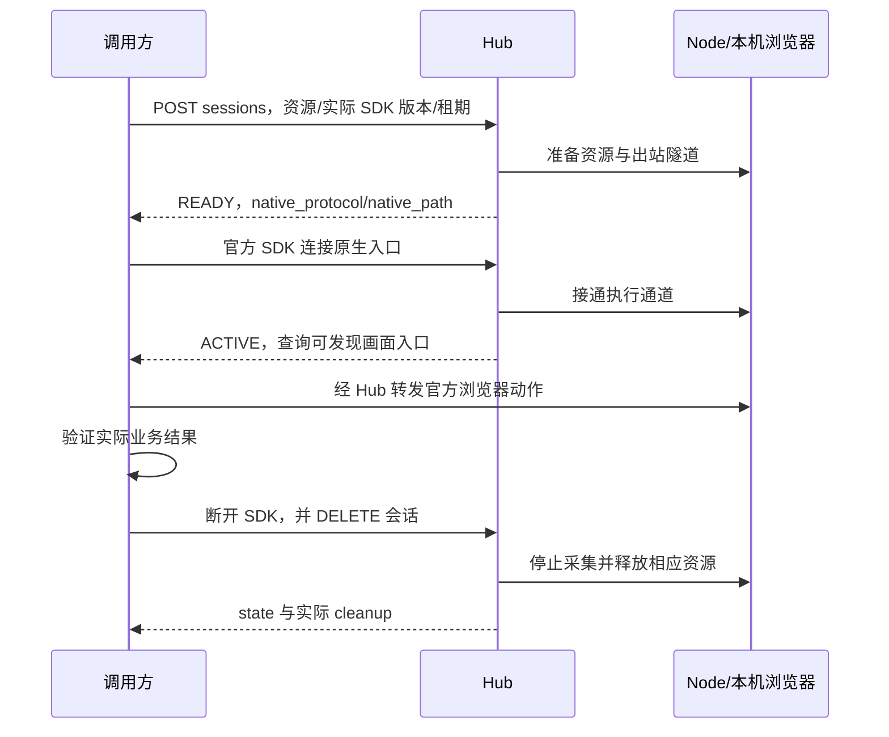

# 调用方对接与使用

[文档导航](../README.md) · [接口总览](../reference/对外接口总览.md) · [完整示例](../reference/examples/README.md)

本指南面向接入 RunBridge 的服务、Agent 或普通脚本，使用 Hub 0.5.1 / Node 0.5.0 的公开接口。调用方负责业务动作和断言；Hub/Node 负责连接、授权与相应资源生命周期，不判断测试业务是否通过。

## 1. 接入前取得什么

向 Node 所有者取得一份私有访问文件 access.json，并确认实际 resource_id。文件包含 hub_url、node_id、grant_id、access_token、expires_at。不需要取得 Node 身份、Chrome 本机端点或浏览器启动配置。

该许可需要覆盖所用资源，且尚未到期或撤销。创建、查询、原生连接、画面订阅和释放使用同一许可；另一个同节点许可不能接管已经存在的会话。将文件保存在调用方自己的私有配置位置，不提交到示例目录或日志。

## 2. 准备独立调用环境

在自己的调用项目根目录，用 uv 创建 .venv 并安装客户端依赖：

```bash
uv venv --python 3.14 .venv
uv pip install --python .venv/bin/python 'playwright==1.63.0' 'httpx>=0.28,<1' 'websockets>=15,<18' -i http://mirrors.aliyun.com/pypi/simple/ --trusted-host mirrors.aliyun.com
```

远程浏览器在 Node 机器运行，调用机器无需执行 playwright install 或下载浏览器。只做 HTTP 查询时不需要 Playwright；只做画面订阅时只需要 httpx/websockets。这里的三者用于完整示例。

将[执行示例](../reference/examples/执行会话调用.py)、[画面订阅示例](../reference/examples/画面流订阅.py)复制到自己的示例目录，或在已安装依赖的 Node 源码根目录按下文路径运行。两份脚本不导入 RunBridge 包，因此调用方不用安装 Hub 或 Node。

## 3. 先确认节点与资源

有 Node CLI 的源码环境可以查询：

```bash
uv run --locked --no-sync runbridge-node inspect node_example --access-file .runbridge/chrome-access.json
```

node_example 替换为实际 ID；纯 HTTP 调用方可以保存下面的代码为 inspect_access.py：

```python
import json
from pathlib import Path

import httpx

access = json.loads(Path("access.json").read_text(encoding="utf-8"))
response = httpx.get(
    url=f"{access['hub_url'].rstrip('/')}/v1/nodes/{access['node_id']}",
    headers={"Authorization": f"Bearer {access['access_token']}"},
    timeout=15,
)
response.raise_for_status()
print(json.dumps(response.json(), ensure_ascii=False, indent=2))
```

在独立调用环境执行 .venv/bin/python inspect_access.py。成功标准是 ONLINE、capabilities_stale=false、所需资源 READY/FREE。资源 ID 来自查询，不从浏览器名称猜测；示例默认已有 Chrome 为 chrome，受管理 Chromium 为 chromium，所有者可自定义。

## 4. 申请 → 官方 SDK 接入 → 实际业务 → 释放



申请示例请求体：

```json
{"resource_id":"chrome","client_version":"1.63.0","lease_seconds":300}
```

POST 返回 201，等待准备的时间可达 30 秒，HTTP 客户端超时使用大于 30 秒的值；示例为 40 秒。传入实际已安装 SDK 版本，不为了通过检查伪造版本号。会话租期 1–3600 秒，实际截止时间不会晚于许可到期。

| native_protocol | 官方连接方法 | 对象与关闭含义 |
| --- | --- | --- |
| playwright | chromium.connect(endpoint=..., headers=...) | 在本次受管理实例创建 Context/Page；结束回收 Node 自建浏览器 |
| cdp | chromium.connect_over_cdp(endpoint_url=..., headers=..., no_defaults=True) | 使用已有 contexts/pages 保留原登录；结束释放借用连接，Chrome 保留 |

native_path 只是路径，需要按 Hub 基址组成 WS/WSS 地址。Authorization 使用访问令牌，不拼到 URL。连接后不能透明恢复旧 SDK 对象；一个会话只接入一个原生调用连接，画面消费者走独立订阅，不占这个连接。

## 5. 运行完整示例

以下在准备好的 Node 源码根目录执行，复用开发环境依赖。独立调用项目将命令前缀改成 .venv/bin/python，脚本与访问文件路径换为自己复制的文件。

已有 Chrome，只读取唯一匹配的原页面：

```bash
uv run --locked --no-sync python doc/reference/examples/执行会话调用.py --access-file .runbridge/chrome-access.json --resource-id chrome --page-url 'https://your-test-system.example/account' --screenshot .runbridge/chrome.png
```

将示例 URL 换为授权实例内已经打开的精确 URL。脚本不导航原页面；有零个或多个匹配时失败并释放会话。URL 匹配只用于示例选页，服务端授权仍为整个浏览器实例。

受管理 Chromium，可使用不依赖外网的默认 data 页面：

```bash
uv run --locked --no-sync python doc/reference/examples/执行会话调用.py --access-file .runbridge/playwright-access.json --resource-id chromium --screenshot .runbridge/managed.png
```

受管理模式访问自己的业务地址时追加 --url http://your-internal-service/。浏览器通过 Node 网络访问该地址；它不是通过调用方网络访问。借用模式也继续使用已有页面所在的 Node 网络。

成功会依次输出 READY 会话 ID、ACTIVE/页面标题/临时 visual、结束状态和 cleanup。指定的截图文件保存在调用方机器。这些结果证明示例连接与截图成功，真实业务须加入独立断言。

## 6. 在官方 SDK 中加入业务操作

在执行示例标注的位置直接编写自己的代码，例如在自己的已授权测试表单上：

```python
from playwright.async_api import expect

await page.bring_to_front()
await page.get_by_role(role="textbox", name="内容").fill(value="测试内容")
await page.get_by_role(role="button", name="提交").click()
await expect(page.locator(selector="#result")).to_have_text(expected="测试内容")
```

角色、名称和断言对象要与真实应用一致，不是 Hub 新增接口。借用 Chrome 时读取已有 context/page；new_context() 不继承原登录。page.close()、导航、修改 Cookie 等动作仍会真实改变原浏览器，断开不会回滚。

无论业务动作是否成功，使用 try/finally 关闭 SDK 连接并调用 DELETE，检查 cleanup。borrowed 的 COMPLETE 表示本次连接及自身采集清理已确认，managed 的 COMPLETE 还包含自建进程回收；都不代表业务 PASS。

## 7. 手动查询与释放

```bash
uv run --locked --no-sync runbridge-node session create --access-file .runbridge/chrome-access.json --resource-id chrome --client-version 1.63.0 --lease-seconds 300
uv run --locked --no-sync runbridge-node session get session_example --access-file .runbridge/chrome-access.json
uv run --locked --no-sync runbridge-node session close session_example --access-file .runbridge/chrome-access.json
```

session_example 替换为实际返回 ID。create 只是 READY，不会执行或开启画面；需要用官方 SDK 接入，才能进入 ACTIVE。自动执行示例会自行申请新会话，不是连接手工 create 的已有会话；不要把两种方式混用来争抢同一资源。

## 8. 同时订阅画面

已有 Chrome 的执行示例增加 --hold-seconds 60，可以保持 ACTIVE，供另一终端或浏览器查看画面；保持时间不延长会话或许可期限。记录输出中的 session_id，然后按[画面接入](浏览器画面流接入.md)运行独立订阅者。消费者退出不结束业务执行；原生连接结束会停止采集和订阅。

错误处理顺序为：确认许可和节点 → 确认资源 → 确认会话 → 检查 SDK 原生错误和实际业务效果。网络超时可能发生在动作已经生效之后，不盲目重放 POST 或业务动作。错误码见[会话参考](../reference/会话接口与原生连接.md)，恢复流程见[排障](../deployment/Playwright运行与排障.md)。
